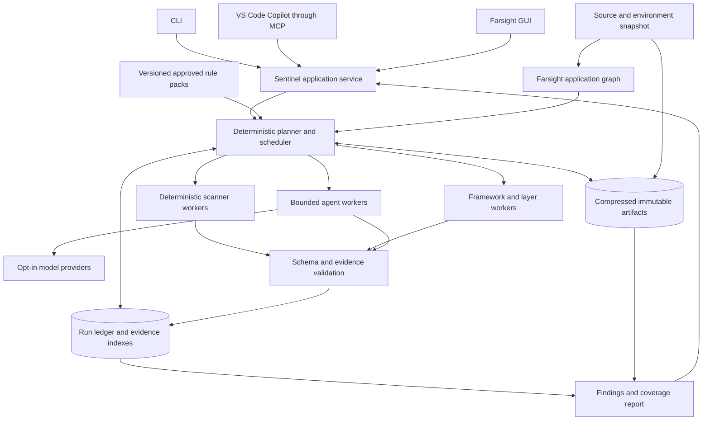

# Farsight Sentinel security scanning proposal

**Status:** draft for review · 2026-10-17 · no Sentinel runtime is implemented by this proposal.
**Verified repository baseline:** `4fce1c8` (PR #115 merged 2026-10-17). Primary-source access date: 2026-10-17.

Farsight Sentinel should be an optional security analysis extension that combines Farsight's code graph,
specialist scanners and bounded agent reviews. Its defining feature is an inspectable execution graph: every
check has pinned inputs, an implementation, attempts, outputs and a coverage record. A stopped run can resume;
a changed rule or model can produce a new assessment against the same saved code; a changed application can
be compared without mistaking missing work for a fix.

**Recommendation:** build a local SQLite run ledger and compressed, content-addressed scan bundles; use
Farsight for application identity, navigation and candidate relationships; integrate established analyzers
through a versioned worker protocol. Keep model providers optional and keep all clients on the same engine.
Use deterministic code for scheduling, evidence validation, comparison and reporting. Let coded and agentic
workers implement compatible analysis stages without pretending they offer identical guarantees.

The user-confirmed first-release requirements are **TypeScript/JavaScript and Java/Spring Boot**, local parsing
and storage, and configurable opt-in model providers. Deliver static scanning first. Accept imported runtime
evidence with provenance; add managed runtime scanning after the static execution and trust boundaries work.

## Reading map

| File | Purpose |
|---|---|
| This proposal | Product scope, phases, architecture, delivery sequence and acceptance criteria |
| [Execution and data contracts](farsight-sentinel/contracts.md) | Draft records, retry semantics, invalidation, commands and configuration |
| [Scanner research](farsight-sentinel/research-scanners.md) | Standards, deterministic engines, licenses, Java support and runtime options |
| [Workflow research](farsight-sentinel/research-workflows.md) | SQLite, Temporal, LangGraph, SARIF, VEX and VS Code integration |
| [Repository fit and research notes](farsight-sentinel/repository-fit.md) | Verified Farsight seams, limitations and additional primary sources |
| [Independent review](farsight-sentinel/claude-review.md) · [Response](farsight-sentinel/codex-response.md) | Preserved review, disposition of each finding, and corrections to the review |
| [Implementation plan](farsight-sentinel/implementation-plan.md) · [PR build plan](farsight-sentinel/implementation-prs.md) · [Code examples](farsight-sentinel/implementation-examples.md) | Draft technical architecture, dependency-ordered delivery and acceptance gates for review before implementation; [independent review of the plan](farsight-sentinel/claude-review-implementation.md) · [response and execution gates](farsight-sentinel/implementation-review-response.md) |

## 1. What Sentinel promises

Sentinel answers: **what was examined, against which rules, by which tool or model, what was found, and what
remains uncertain?** Findings lead the report, but every planned check is inspectable, including checks with
no finding, unsupported checks, failures, reused results and unfinished work.

| Use case | Required behavior |
|---|---|
| Scan an API, application or multi-service workspace | Inventory code and non-code attack surfaces; run the selected profile; expose coverage gaps |
| Stop and continue | Resume durable work after process exit, with previous attempts and completed artifacts preserved |
| Add or update rules | Replan applicability for every relevant surface, reusing only compatible upstream artifacts |
| Change a model | Rerun selected agent assessments against identical evidence; preserve both models' outputs |
| Follow code changes | Save a new snapshot, calculate affected analysis, and disclose why each result ran or was reused |
| Compare over time | Separate code change, rule change, model change, database change and disposition change |
| Explain a false flag | Retain the original observation and the scoped, evidenced decision that changes its treatment |
| Understand the application consequence | Place a finding or gap on known screens, journeys and personas through the same canonical graph, with a business-register sentence and pinned evidence; show an explicit limitation when context is unavailable |
| Use CLI, Copilot or GUI | Submit, inspect and resume the same durable run, independent of the client session |

There is no universal “secure” score. A successful scan means its declared plan completed under stated limits.
Static reachability is not proof that a path executes, and an unresolved call is not proof that it cannot.
The deterministic CLI/MCP/GUI checkpoint is independently releasable; optional model review has separate
quality, disclosure and cost gates, as sequenced in the implementation backlog.
The first release does not promise exhaustive path enumeration, all CWE detection, arbitrary plugin execution,
automatic remediation, or a shared multi-user service.

## 2. Architectural shape

The **application graph** remains Farsight's single semantic graph. The **execution graph** is a separate
operational ledger of work and artifact dependencies. A finding references immutable source/artifact locations
or resource identity, and original application node IDs where available; CI and infrastructure findings need
no invented application node. Sentinel does not make a competing application schema. Large analyzer databases,
flow evidence, source blobs and prompts stay outside `/graph`. All surfaces read the same Sentinel service.

### Proposed package boundaries

Start with one optional package and a narrow bridge; split more packages only when a second consumer needs it.

| Boundary | Responsibility and dependency direction |
|---|---|
| `packages/sentinel` | Versioned contracts, rule registry, planner, SQLite ledger, artifact store, worker supervision, findings and exports; includes the `farsight-sentinel` bin and stdio MCP server; consumes public graph/code-parser APIs with no server/viewer runtime dependency |
| Farsight host bridge | A small explicitly enabled capability delegates `farsight sentinel …`, server requests and GUI views to the installed Sentinel service; no scanner or model dependency in default Farsight startup |
| Worker adapters | Initially trusted built-in adapters that launch pinned external binaries or approved model endpoints; third-party workers later use the same protocol and explicit installation/trust |
| Framework packs | Versioned TS/JS and Spring semantics, fixtures, locators and layer summaries; analysis artifacts refer back to canonical graph IDs |

Use a versioned, bounded JSON protocol over stdio for scanner workers and a permission-protected local IPC
endpoint for the optional host bridge. Do not load arbitrary repository-supplied JavaScript into the viewer or
coordinator. A manifest declares supported languages/framework versions, required capabilities, inputs, outputs,
read set, time/memory budgets and network/build needs. Compatibility is checked before work starts.

The first implementation PR must add an ADR to `docs/ARCHITECTURE.md` and a package entry in
`docs/MAP-PACKAGES.md`. This draft does not record Sentinel as shipped architecture. PR #115 merged at
`4fce1c8`: Sentinel's snapshot stage consumes `@farsight/code-parser`'s `parseRepository()` artifact
(fingerprints, file outcomes, diagnostics, `complete`) and `@farsight/graph`'s portable document. Application
`ingestRepo()` remains an optional enrichment path, never the security inventory or coverage denominator.

Reuse Echo's bounded model-transport patterns through a small provider-neutral seam when Sentinel becomes
a second consumer; do not import Echo's memory application or use its transient jobs as the scan queue.
Keep semantic-backend selection separate from scanner selection, following the existing
[analysis-core research](../research/analysis-core-options-2026-10-17.md).

### Initial adapter choices

| Need | Recommended first choice |
|---|---|
| Application context and supported entry points | Existing Farsight parsers plus measured Sentinel framework packs |
| Fast source detectors and locators | Opengrep or Semgrep CE with original local Sentinel rules, telemetry off and explicit limits; choose the default through E3; Sentinel owns finding fingerprints |
| Dependency advisories | OSV-Scanner with a pinned local advisory database |
| Secrets | Gitleaks with separate tree/history scope and redacted outputs |
| Infrastructure and containers | Trivy with explicitly selected scanners |
| GitHub Actions and supported CI configuration | zizmor, with offline/online audit coverage disclosed |
| Deeper cross-file data-flow evidence | User-installed CodeQL with user-attested applicable entitlement/terms; Semgrep Code where licensed; evaluate Joern with written Spring semantics; Bearer CLI is an additional SAST candidate, with advanced cross-file capabilities separately evaluated/licensed |
| Judgment and novel findings | Configurable bounded model workers, off by default |
| Runtime scanning | Import evidence initially; managed ZAP later |

The baseline profile supplies structural/path context and local checks. A deep-analysis profile adds a validated
cross-file engine and its declared capabilities. An unavailable engine leaves the relevant deep checks unsupported;
an agent review can add evidence but cannot silently convert them to completed deterministic checks. Engine and
rule-pack licenses are separate release gates. See [scanner research](farsight-sentinel/research-scanners.md).
Sentinel never downloads CodeQL; record the installed binary, applicable terms reference and
`entitlement: user-attested`. Original rules are the initial distribution policy for either pattern engine.

## 3. The five phases

Phases are groups in a dependency DAG, not five giant transactions. Each contains small work units with durable
completion. Deterministic and agentic implementations can share a stage contract if their outputs satisfy it;
their evidence strength and capability claims remain distinct. Agents may propose parsing corrections or rule
changes, but canonical source hashing, graph ingestion, coverage arithmetic and result validation stay coded.

| Phase | Pinned inputs | Durable outputs | Execution |
|---|---|---|---|
| 0. Rules | Upstream standards, existing packs, organization policy | Reviewed rule revisions, fixtures, source/license manifest, lockfile | Coded update/validation; agent proposals; authorized promotion |
| 1. Snapshot | Authorized repositories, configuration and capture policy | Compressed source bundle, security inventory, canonical graph, parse outcomes | Coded capture and parsing |
| 2. Shared layers | Snapshot, graph, framework models | Scoped control summaries, order/applicability evidence, unresolved boundaries | Coded extraction plus attributed agent review |
| 3. Checks | Rules, surfaces, layers, engine/model policy | Check plan, attempts, observations, paths, coverage and progress | Parallel coded/scanner/agent workers |
| 4. Report | Validated observations, check ledger, dispositions, baseline | Findings, full check inventory, comparisons and reproducible reports | Coded folds/exports; optional attributed narrative |

### Phase 0: prepare and maintain rules

Use CWE as a weakness taxonomy, OWASP ASVS as versioned verification requirements, and OWASP Top 10/API Top 10
as reporting groupings. A taxonomy entry is not an executable detector. ASVS publishes machine-readable
requirements and recommends version-qualified IDs; pin these rather than following a mutable “latest” label.
([OWASP ASVS](https://owasp.org/projects/asvs), [CWE downloads](https://cwe.mitre.org/data/downloads.html))

A rule pack contains applicability, detector and locator references, review instructions, evidence requirements,
positive/negative fixtures, limitations, mappings, severity guidance and license/provenance metadata. A locator
finds candidates; it cannot clear everything it did not select unless its completeness is independently established.

`rules update` fetches approved upstream sources into a staging area, records release IDs and hashes, and produces
a reviewable diff. An agent may research new weaknesses or draft detectors and tests. Promotion requires the
pack's conformance and regression checks and an authorized maintainer decision. Scans use an immutable lockfile;
an update never changes an in-flight run. Support offline packs, rollback and organization-specific additions.

Keep deployment assertions and disposition decisions alongside, but separate from, the rules. “Our gateway
protects this” is a claim with an owner, scope, evidence dependencies and expiry, not an exemption embedded in
the universal detector. Rule retirement remains visible in comparisons rather than looking like a code fix.

### Phase 1: freeze inputs and prepare the analysis space

Create a consistent local snapshot before parsing. Store the exact included source bytes, file metadata/hashes,
repository identities and commits, dirty-tree digest, includes/excludes, language/tool versions, dependency
manifests and locks, CI/CD and infrastructure configuration, selected environment profile and rule lock.
Capture multiple repositories as one manifest; label revisions as independently captured unless coordinated.

The security inventory must include dot-directories such as `.github/workflows`. Farsight's current file walker
and language-only digest do not provide that coverage. Generate a full SHA-256 manifest over Sentinel's explicit
inputs; retain Farsight's digest as a separate freshness fact. Unreadable, excluded, generated, unsupported and
unparsed files each get a recorded reason. Never silently classify them as scanned.

`Snapshot.fileInventory` is authoritative. Its exclusive primary classes are `parsed`, `parse-failed`,
`excluded-by-policy`, `unsupported-type`, `generated`, `binary`, `too-large`, `symlink-refused` and
`seen-by-no-stage`; stage-specific coverage is a separate dimension. The report always prints the count and
scope seen by no stage, including zero. Inventory policy records precedence and excluded directory boundaries
so generated/binary files cannot disappear or be counted twice. Files not individually enumerated below an
excluded or unreadable directory are an explicit unknown scope, not an invented file count.
Generated files are analyzed only when present in the authorized snapshot or supplied by an approved build
profile; whether Sentinel may run Maven/Gradle is an owner decision.

Parse the snapshot with `parseRepository()` and consume its file outcomes, diagnostics, exact fingerprints and
completion limits. This API does not read application configuration or run OpenAPI/design/test enrichment.
Reconcile its selected files with Sentinel's wider inventory; parser `complete` is not whole-workspace security
coverage. E1 checks that this reconciliation survives enrichment. The current `ingestRepo()` path calls the
low-level extractor and does not expose the same analysis ledger; preserve the direct artifact independently.
For application enrichment, record the producer per fact and use a stripped environment with network denied,
`design: false`, and local-only pre-acquired OpenAPI inputs. Until a policy-aware local-resource boundary exists,
disable URL-capable passes rather than assuming an environment scrub prevents a fetch. Hash every explicitly
acquired external resource before it enters the snapshot. Persist both parse evidence and enrichment provenance.
Scanners consume the same frozen snapshot. Source blobs and analysis artifacts are losslessly compressed and
deduplicated; summaries are additional artifacts, never replacements for executable code. A portable private
scan bundle includes the report, manifest, database export and referenced artifacts. A shareable redacted report
may omit source and prompts and must say it cannot support a full replay.

### Phase 2: analyze shared layers and controls

Build reusable summaries of middleware, decorators, interceptors, guards, dependency injection, shared services,
serializers, authorization and validation helpers, exception handlers, session/cookie handling, outgoing clients
and data access. Resolve applicability and order from code and configuration, with provenance for every relation.

For Spring, distinguish servlet filters, the first matching `SecurityFilterChain`, method security, MVC
interceptors, AOP proxies and reactive chains. Profiles, matchers, ordering and proxy behavior are inputs.
Spring documents first-match chain selection and warns that MVC interceptors can be unsuitable as a security
layer because of matching differences. An annotation or a nearby interceptor is therefore insufficient evidence
that an endpoint is protected. ([Spring Security](https://docs.spring.io/spring-security/reference/7.0/servlet/architecture.html),
[Spring MVC](https://docs.spring.io/spring-framework/reference/web/webmvc/mvc-config/interceptors.html))

For TS/JS, start with Express/Nest request handling and Next middleware applicability, preserving registration
order, router mounts, guards, interceptors, validation pipes and error paths. Publish an explicit framework/version
support table; Fastify, GraphQL, WebFlux and custom dispatch have separate capabilities and gaps until validated.

Until a layer pack with the `framework-order` capability has run for the relevant scope, Spring and Express/Nest
endpoint protection is `unknown`; annotations and name-matched middleware raise candidates and clear nothing.
A check requiring that capability is `unsupported`, not a completed negative result. Next's existing
`middleware.ts` heuristic applies beneath its folder without reading `config.matcher`; matcher-aware applicability
is the first TS/JS layer deliverable. A layer pack declares the framework versions it was written and tested
against; the supported first-pack versions remain an owner question.

A coded extractor produces structural facts; an agent can explain custom controls and propose missing links.
Those proposals retain citations and uncertainty. A layer summary states what the control guarantees, where it
applies, where it is bypassed, which environment it assumes and which files/configuration invalidate it.
Recursion and cyclic dependencies use bounded fixed-point summaries; failure to converge is recorded.

### Phase 3: plan and execute the checks

First enumerate attack surfaces independently of findings: HTTP routes, RPC/GraphQL handlers when supported,
message consumers, scheduled jobs, CLI commands, webhooks, browser inputs, file imports/uploads, outbound calls,
data stores, build/release workflows, dependency resolution, containers and deployment configuration. Reconcile
code-discovered routes with specifications; a specification-only route remains a coverage gap, not runnable proof.

Materialize a check matrix for `(surface or scope, rule revision, environment, analysis mode)`. Each tuple has
an applicability decision and either a scheduled implementation or an explicit unsupported/disabled reason.
Represent repository-wide checks once, with their scope, instead of multiplying dependency or secret findings
across every endpoint. Allow new surfaces discovered by a worker only through a recorded planner revision that
extends the inventory and schedules applicable checks.

Run four lanes in parallel within configured budgets:

1. **Deterministic detectors:** local patterns, dependency advisories, secrets, infrastructure and workflow checks.
2. **Path analysis:** traverse each supported entry point through shared layers, calls, data access and exits;
   apply specialized cross-file analyzers where available and preserve path conditions, sources, sinks and barriers.
3. **Rule-guided agent review:** inspect bounded evidence packs for rules requiring semantic or business-context
   judgment, including unresolved framework behavior and authorization boundaries.
4. **General model review:** an independently recorded review using the model's knowledge, partitioned across the
   application, shared layers and deployment surfaces; it is not limited to existing detector hits.

The general review has its own model/prompt identity and inspected-file coverage. A novel finding can have no
confirmed CWE until mapped; preserve its rationale and citations. It can propose a new rule candidate for phase 0,
but cannot silently promote it or claim completion of unrelated formal checks.

Avoid enumerating every possible execution path. Use indexed traversal, strongly connected components, reusable
function/layer summaries and explicit branch/dispatch frontiers. When path, token or time budgets are exhausted,
record the frontier and mark the affected check incomplete. Multi-repository edges require explicit service
identity and environment routing evidence; a coincident URL pattern remains a candidate link.

The existing graph helps locate and contextualize work, but lacks full control-flow/data-flow guarantees.
Semgrep CE's intrafile analysis can include cross-function behavior within a file, but cannot supply general
cross-file proof. Offer CodeQL and commercial Semgrep as configured integrations,
and evaluate Joern as an optional open-source deep-analysis backend. The default profile must disclose narrower
coverage when a deep engine is unavailable. See the [scanner comparison](farsight-sentinel/research-scanners.md).

### Phase 4: validate, adjudicate, compare and report

Validate evidence before accepting outputs: cited file and span exist in the pinned snapshot, hashes match,
claimed paths refer to real evidence, structured output conforms, and reported scope does not exceed inspected
scope. Citation validation establishes traceability, not that a model's security judgment is correct.

Preserve raw observations from every engine. Correlate them into candidate finding groups using weakness,
source/sink/control identity and location evidence; keep different vulnerabilities separate even if their CWE
and line coincide. Human decisions or an explicit trusted adjudication policy determine accepted dispositions.
Agents can recommend dispositions; model disagreement remains visible.

Generate JSON and a readable HTML/Markdown report deterministically, with optional clearly labeled model-written
explanations. SARIF is an export for compatible findings and code flows, not the database for the whole process.
Report generation can be rerun against retained evidence without invoking a model or rescanning source.

## 4. False flags and compensating controls

Use separate facts for **observation**, **assessment**, **disposition** and **current validity**. A suppressed
finding still exists, still contributes to the all-checks ledger and still carries the original tool/model record.

| Disposition | Meaning |
|---|---|
| False positive | The alleged weakness is absent or the detector misinterpreted the code; cite the counter-evidence |
| Mitigated by a control | The issue is prevented in a specific environment/path by an evidenced control |
| Accepted risk | The issue remains and an authorized owner accepts it within a stated scope and time |
| Needs review | The evidence or environmental claim is insufficient or conflicting |

These are Sentinel assessment states, not additions to Farsight's graph evidence classes or absence vocabulary.
Every decision records actor, time, rationale, affected finding/rule/scope, evidence hashes, environment and
expiry/review condition. Repository-authored suppression requests cannot approve themselves in an untrusted PR.
An invalidated decision reopens review; it never deletes the historical decision.

External controls use a `DeploymentAssertion` record: owner, environment/deployment identity, claimed property,
scope, evidence references and hashes, last verification, expiry and trust level (`asserted`, `imported-config`,
or `runtime-observed`). These describe assertion provenance, not new application-graph evidence classes.
Imported configuration must be tied to the relevant deployment; a runtime observation establishes only the
property and scope actually observed. An unverified assertion can explain a pending decision but cannot satisfy
the exit-code policy or turn a finding into an effective mitigation.

A disposition's scope must be a subset of the finding's affected scope. If a gateway covers one route but
another bypasses it, report the covered and uncovered paths separately. New entry points, reduced resolution
confidence, framework-version changes, control changes and assertion expiry invalidate the dependent decision.
Comparison explicitly reports `reopened: disposition expired` when that is the cause.

**Cookie example:** a service sees a plaintext value after middleware decrypts a cookie. Keep the local detector
observation, then inspect both inbound verification/decryption and outbound issuance/encryption, authentication
of the ciphertext, route coverage, order and bypasses. Decryption alone does not prove safe issuance. Cookie
payload confidentiality, tamper protection, TLS, `Secure`, `HttpOnly` and `SameSite` are different properties;
one compensating control cannot waive all of them. An opaque random session identifier need not itself be an
encrypted payload. ([OWASP session guidance](https://cheatsheetseries.owasp.org/cheatsheets/Session_Management_Cheat_Sheet.html))

If the relevant gateway is outside the captured sources, retain the assertion as unverified unless matched
deployment/runtime evidence establishes it. When the control, matcher, configuration, deployment identity or
dependent caller changes, invalidate the mitigation and rerun its dependent checks, even if the service file
is unchanged.

## 5. Resume and differential analysis

Every run pins its inputs. Every work unit has immutable attempt records and explicit upstream dependencies.
Completion commits artifact references, observations and coverage in one ledger transaction after output files
are durable. Local child workers belong to one coordinator epoch and attempt; publication revalidates both.
After a coordinator crash, reconcile and stop surviving owned processes before replacement work starts;
a process group alone does not guarantee they died. Client-hosted review additionally uses expiring claims,
heartbeats and fencing generations. A crash may repeat execution or a paid model call; it must not publish
duplicate accepted results. Confirmed spend after cancellation is `canceled-after-spend`; unknown provider
completion remains unknown usage, never zero cost.

Resume retries incomplete work on the **same** pinned inputs. Rerunning with changed code, rules, model, policy
or environment creates a child run with lineage. A forced rerun also creates a child run, with fresh attempts
even if cache keys match. Newly accepted outputs determine downstream fingerprints and force dependent work
to be reevaluated before any reuse; the parent report remains unchanged.
Completed work is reused only with a recorded derivation and compatible fingerprint; “reused from run X” is
different from “executed now.” No in-memory “already checked” flag is authoritative.

Differential selection includes changed code and reverse dependencies, global control/configuration changes,
new/deleted entry points, rule applicability changes, advisory-database updates and suppression evidence changes.
The dependency set includes all inputs that could change a result, not just the files an agent happened to open.
Use a whole-service or whole-repository dependency when precision cannot be justified. New or unresolved dispatch,
changed framework models, missing baselines and incompatible schemas trigger broader analysis.

Three cases need explicit invalidation rules. A framework lockfile bump reruns layer semantics and dependent
checks even with unchanged application code. A narrowed rule produces `changed detection`, not `resolved`.
An added, removed or renamed declaration can change a LOW-confidence name-based call resolution even when
the caller is untouched, so re-resolve every affected candidate scope and broaden when that scope is unknown.
Occurrence IDs anchor call-site evidence within a snapshot; their coordinate-dependent hashes do not provide
stable issue identity across moved spans. Retain old edges, resolution confidence and framework versions as
inputs to invalidation and use a separate, versioned finding matcher across snapshots.

Keep a periodic full-scan comparison as a separate quality gate for the incremental engine. Compare reports on
both common scope and newly added scope. A finding is resolved only when a comparable, completed check covers
its former scope with the relevant capability; removal of a rule, missing tool or unscanned path is not resolution.
Comparability requires the same rule revision, engine digest and relevant capability set, or a recorded reviewed
compatibility mapping; otherwise show `changed detection`, retaining the historical finding for review.

## 6. Clients and report experience

The CLI provides plan, run, status, pause, resume, retry, compare, report and rule-management operations.
Long work runs in a coordinator process independent of GUI/MCP connections; foreground CLI execution can also
be restarted from the ledger. Initial Copilot integration uses MCP tools with bounded replies and durable run
IDs. Use the existing SARIF Viewer extension for findings in increment E. A custom VS Code extension is optional
later for rerun/disposition actions and stronger host-reported identity through `vscode.lm`.

Copilot can initiate configured workers or submit an explicitly identified external-agent assessment. The latter
cannot claim a provider/model/version the client does not expose: record unknown identity and client-attested
metadata separately. Closing chat does not cancel the coordinator. MCP tool trust does not replace Sentinel's
workspace, provider, build or runtime-scan policy. See [workflow research](farsight-sentinel/research-workflows.md).

In the GUI, show a Sentinel overview with actionable findings, incomplete coverage and the run's inputs first.
An execution view shows phases, work units, attempts, inputs/outputs, elapsed work and retry controls. A finding
opens evidence and the associated Farsight path. An all-checks table supports rule, surface, model, status and
environment filters; a comparison view separates changed findings from changed assessment conditions.

The report contains:

- Scope and snapshot identity, environment, exclusions, parser failures and unsupported frameworks.
- Open findings ranked by impact and confidence, with code evidence, affected paths and remediation guidance.
- False positives, mitigations and accepted risks, with decision evidence and invalidations surfaced prominently.
- Every planned check, applicability reason, execution/reuse outcome and coverage limitation.
- Stage and model inventory: tool/script version and hash, rule revision, provider/model identity, prompt and
  context references, budgets, attempts, costs when available, and concise evidence-based rationales.
- Baseline comparison, newly discovered surfaces, changed rules/models/databases and recheck instructions.
- Artifact manifest and integrity status; source-retention/redaction limits affecting future rescans.
- A deterministic/agent agreement matrix per model: both flag, deterministic only, agent only, neither, and
  incomparable coverage; distinguish the same issue from a related issue sharing a sink. Keep producer
  observation counts separate from correlated issue counts. Disagreement
  is not ground truth; measure agent under-reporting against labeled cases, with repeated-trial variability.

Progress is completed versus planned work units for the current plan revision, not an invented completion-time
percentage. Planned totals can grow and that change is visible. All GUI counts use `Counted` and scoped
breakdowns from shared CLI/MCP/report folds, so denominators agree across clients; vocabulary, glyphs and
tooltips follow the existing catalogs and `sym()` conventions. No security
score conflates successful scheduling with verified application safety.

## 7. Sentinel's own security boundary

Analyzed repositories, comments, tool outputs and model responses are untrusted data. Agents receive read-only,
scoped evidence tools; they do not inherit repository instructions, unrestricted shell access, scanner trust,
rule-promotion rights or suppression authority. Allowlisted reads and schema/citation checks are enforced by
code outside the model. These controls address the indirect prompt-injection risk in source comments and
documentation. ([OWASP guidance](https://cheatsheetseries.owasp.org/cheatsheets/LLM_Prompt_Injection_Prevention_Cheat_Sheet.html))

Local stores use owner-only access; credentials remain OS-keychain references. Provider policy explicitly
controls which source classes may leave the machine, endpoint identity, retention and training terms with their
source/access date, and budgets. A hosted provider is itself an external disclosure channel; the agent's evidence
tools never fetch URLs. Planning estimates context/tokens and cost before a general review; trusted settings
require `maxTokensPerRun` and `maxCostPerRun`. Reserve budget before dispatch, stop admission at the cap and
conservatively retain reservations for unknown usage rather than claiming a hard spend guarantee unsupported
by provider metering. Rendered reports cannot load external images or other remote content automatically.
Never infer provider identity from the model's own text.
No remote inference occurs in deterministic-only mode. Dependency database refreshes are separate network
operations with a captured database version; offline runs say when advisory data was last refreshed.
Manifests distinguish dependency resolution (`none`, `local-cache`, `remote`), database fetches and telemetry
from builds and runtime targeting. A nominal no-build scan may still resolve dependencies over the network.

E5 pairs clean and canary-bearing evidence packets across repeated trials, checking whether comment instructions
alter verdicts, citations or tool requests. A zero-observed-influence threshold is an empirical release gate for
that corpus, subject to owner confirmation, not proof of universal prompt-injection resistance. Deterministic
tool restrictions remain enforced regardless of model output. Provider and attack references are retained in
the [workflow research](farsight-sentinel/research-workflows.md).

Workers get an immutable source view, isolated scratch space, controlled environment, bounded resources and
denied network unless granted. A child process is not a sandbox: build-capable or untrusted workers require an
actual OS/container isolation backend with no host credentials. Never run Maven/Gradle/npm project code merely
because an analysis tool calls a mode “no build.” Inspect the adapter's actual behavior and require declared
capabilities. Approved tool binaries and rule packs are pinned; workspace configuration cannot authorize itself.

Private bundles may contain source, secrets and prompts. Separate private replay artifacts from redacted
exports, use optional encryption with keys outside the bundle, validate archive paths and expansion limits,
and pin report-referenced artifacts against garbage collection. Hashes detect corruption; they do not prevent
an owner from rewriting a local database. Signed manifests/external attestation are a later audit feature.

## 8. Delivery plan and release gates

These are delivery increments, not a calendar estimate. The implementation backlog specifies their dependency
order: deterministic interfaces can ship before optional model review. Run feasibility work before committing
to deep-analysis coverage or performance targets. The first usable release includes both language families.

| Increment | Deliverable | Exit evidence |
|---|---|---|
| A. Feasibility and contracts | TS/Express/Nest/Next and Java/Spring fixture corpus; engine comparison; snapshot/worker contracts; package ADR | E1 inventory honesty, E2 chain semantics, E7 offline coverage; named capabilities and gaps; license/installation matrix; measured engine/resource behavior |
| B. Durable deterministic vertical slice | Phase 0 locks; frozen bundles; ledger; CLI; local detectors, secrets, dependencies and CI/IaC adapters; report | E4 crash safety on the simplified protocol; exact inputs recover; all checks recorded; no silent remote calls |
| C. Shared layers and entry points | TS/JS and Spring layer packs; entry inventory; cross-file evidence integration; per-surface planning | Known-good/bad controls, matcher/order/bypass fixtures, unresolved dispatch and missing-engine cases produce correct findings or explicit gaps |
| D. Optional agent reviews | Opt-in provider adapter; guided and general review lanes; evidence validation; model-specific interfaces | E5 labeled repeated trials, canaries, attribution and agreement; invalid citations rejected; authority stays bounded; model rerun from retained source |
| E. Deterministic release interfaces and decisions | MCP flow, Farsight GUI, placed findings/gaps, scoped dispositions, JSON/HTML/Markdown/SARIF export, full-run comparisons; independent of D | CLI, MCP and GUI show identical results and scope; client disconnect preserves jobs; source bundle restores; changed controls reopen affected mitigations |
| F. Differential acceleration | Dependency invalidation, explicit reuse, baseline comparison and full-scan audit | E6 incremental/full equivalence on controlled edits; global controls and new surfaces trigger all required work; missing evidence broadens scope |
| G. Managed runtime analysis | ZAP adapter, authenticated test environments, passive traffic analysis followed by scoped active testing | Approved target/environment, state-reset strategy, request provenance, rate/time limits and cancellation; no production default |

Increment F can ship after the deterministic release. Saved snapshots, rule reruns and full comparisons are
required in E; model reruns ship with D. The worker protocol permits imported runtime evidence before G,
without launching requests.
Experiments [E1–E8](farsight-sentinel/claude-review.md#6-experiments-prioritised-with-acceptance-criteria) all belong
to increment A's feasibility work; later increments rerun the relevant checks as release gates. None was run
for this proposal. E3/E5 thresholds remain owner questions; the response records qualifications to the review's
test wording, including diagnostic line availability, child cleanup and canary interpretation.
ZAP's baseline crawler still contacts the target, while its active API scanning has a different impact profile;
these must be separate capabilities. ([ZAP baseline](https://www.zaproxy.org/docs/docker/baseline-scan/),
[ZAP automation](https://www.zaproxy.org/docs/automate/automation-framework/))

### Tests that decide whether this works

Use WebGoat as a labeled Spring corpus, Juice Shop for JS/TS application cases, and OWASP BenchmarkJava for
part of the Java analyzer evaluation. BenchmarkJava is not a Spring corpus. Add synthetic, reviewable fixtures
for middleware ordering and unsupported semantics; pin all corpus revisions and framework versions as recorded
in [scanner research](farsight-sentinel/research-scanners.md). Corpus results are not whole-product guarantees.
([OWASP Benchmark](https://owasp.org/projects/benchmark))

Required scenarios include a cross-file injection flow; authorization present but applied after a sink; two
overlapping Spring chains; a Next matcher excluding a route; async/exception bypasses; middleware outside the
snapshot; a new entry point after a baseline; a changed dependency advisory with unchanged code; renamed and
deleted source; partial scanner output; cancellation during model generation; corrupt/missing blobs; and
worker completion after an epoch/attempt replacement or external claim expiry. Include negative controls to
measure false-positive behavior.

Report per-rule precision/recall on labeled fixtures, unresolved-flow rate, planned/completed/unsupported checks,
resume duplication, full-versus-incremental differences, bundle size, peak memory, elapsed time and model cost.
Keep agent evaluation outputs versioned; use fixed evidence and repeated trials to measure variability. Do not
choose a model based on unmeasured vendor claims.

## 9. Decisions and remaining implementation choices

The later [implementation plan](farsight-sentinel/implementation-plan.md#1-decisions-and-release-boundary)
records the owner's answers to questions 1–3: local first while preserving a hosted option, source-only first
release with isolated builds later, and Ollama plus a configurable hosted endpoint. Questions 4–5 remain
review decisions. The original questions below are retained verbatim for traceability.

**Questions for the owner, copied verbatim from the review:**

1. Will Sentinel ever be offered as a hosted or managed service? This decides Bearer (ELv2), the Semgrep rules
   licence posture and the CodeQL terms in one go.
2. Is an isolated build profile that runs Maven/Gradle (project plugins included) acceptable for Java? Without it,
   bytecode tools and generated code are out, and the report says so.
3. Which model providers are in scope for the first release, and is a local model (Echo's Ollama path) a required
   profile? The provider adapter's retention and training terms are a field either way.
4. The proposed thresholds in E3 and E5.
5. Supported framework versions for the first packs (Spring Boot 3.x and 4.x, Spring Security 6 and 7, Next 14 and
   15, Express 4 and 5, Nest 10 and 11 are the candidates; each pack states what it was written against).

**Recommended now:** optional extension; one canonical application graph; separate execution ledger and artifact
store; both requested language families; local-first operation; pinned rules; established scanner adapters;
explicit coverage; evidence-bound dispositions; MCP-first Copilot integration; managed runtime scans later.

The feasibility increment supplies evidence for the owner to settle supported frameworks, and must determine the deep-analysis default
for users without a commercial engine, distribution terms for each selected rule pack, measured resource
budgets, and source-retention defaults. Model selection is configurable and benchmark-driven, not a prerequisite
for deterministic scanning. Remote team execution/authentication and third-party plugin distribution need
separate decisions; neither should delay the local architecture.

The quoted questions preserve the review's wording, not new product decisions. Generated source already present
in a captured snapshot can be inventoried without running a build; generating absent code and bytecode analysis
remain conditional on the owner's build-profile decision. License qualifications and verified corrections are
recorded in the [review response](farsight-sentinel/codex-response.md).
