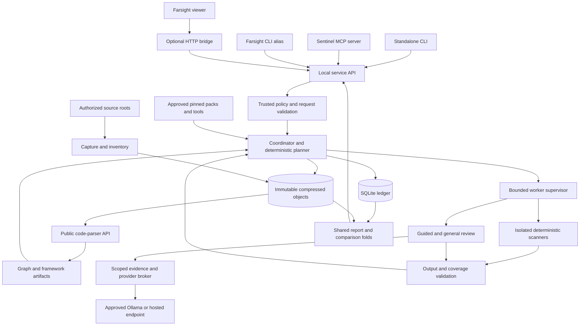
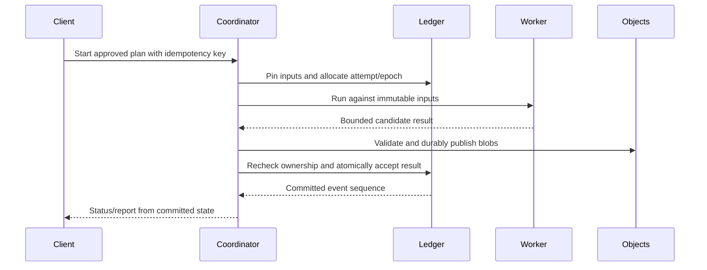

# Farsight Sentinel implementation plan

**Status:** draft for owner review, 2026-10-17. Implementation has not started.
**Baseline:** application `4fce1c8`; proposal merged in PR #117 at `04c3c63` (authored as `354a184`).

Build Sentinel as an optional local security-analysis service with one durable execution ledger, immutable
source/evidence artifacts, replaceable scanners, and bounded model reviews. Deliver a complete deterministic
scan before adding framework semantics and model review. Ship a deterministic checkpoint with CLI, MCP and GUI
access without waiting for model evaluation. Add optional model lanes through a separate dependency track;
incremental acceleration, isolated builds and managed runtime testing follow later.

This plan translates the [proposal](../farsight-sentinel.md), [contracts](contracts.md),
[independent review](claude-review.md) and [review response](codex-response.md) into buildable changes.
The proposal governs product intent. The refinements below are proposed implementation decisions to review,
not silent amendments or claims that Sentinel already exists.

| Read | Purpose |
|---|---|
| This file | Complete architecture, decisions, trust boundaries, lifecycle and release gates |
| [PR build plan](implementation-prs.md) | Ordered PRs, dependencies, owned files, acceptance evidence and demonstrations |
| [Implementation examples](implementation-examples.md) | Parser integration, contracts, SQL, publication, rules, model review and invalidation |
| [Implementation review](claude-review-implementation.md) · [Response](implementation-review-response.md) | Preserved feedback and the disposition, correction and execution gate for every finding |
| [Existing research](research-scanners.md) · [workflow research](research-workflows.md) | Scanner and platform evidence, licensing qualifications and alternatives |

## 1. Decisions and release boundary

### Confirmed by the owner for this plan

- **Local first, preserve a future hosted option.** Keep provider/scanner adapters replaceable; avoid making
  a restricted engine or rule distribution essential to the product. Hosting is a future architecture and
  licensing review, not a promise that the local SQLite service is already multi-tenant.
- **Source-only first release.** Do not execute Maven, Gradle, npm scripts or target-supplied plugins.
  Existing generated source can be captured as source. Producing missing generated code, build-derived
  bytecode and analyzers that invoke project tooling require the later isolated-build track.
- **Ollama and a configurable hosted endpoint.** Ship an Ollama adapter and a capability-tested
  OpenAI-compatible HTTP adapter. Compatibility is verified per endpoint; it does not imply support for
  every vendor feature. Both are optional, and hosted disclosure requires trusted local configuration.

### Proposed defaults to review

| Decision | Proposed choice | When it must be settled |
|---|---|---|
| Supported hosts | macOS and Linux; no Windows support claim in v1 | PR 01 platform probes |
| Scanner isolation | Proposed: Linux containers for external scanners, no automatic host fallback. PR 01 tests Docker Engine on Linux and Docker Desktop plus Colima with Docker on macOS; exact versions/results determine support | Owner decision before external-scanner probes; PR 01/07 |
| Required local installation | Node 24 with verified SQLite runtime; container runtime for external scanners; no scanner download during a scan | PR 01/26 |
| Default pattern engine | Evaluate Opengrep first, compare Semgrep CE on identical original rules; select from measured results | PR 01/10 |
| Deep analysis | Optional capability; original cross-file fixtures decide whether any engine qualifies; unsupported checks stay visible | PR 01/18 |
| Framework matrix | Prioritize one fixture-pinned minor line in each of Next, Express, Nest and Spring Boot/Security; expand only with passing fixtures | PR 01, before PRs 14–17 |
| Admission limits | One heavy scanner plus one model operation per coordinator; memory and token reservations additionally constrain admission | PR 07/21, measured in E8 |
| Retention | No automatic deletion in v1; explicit inspect/pin/prune, disk quotas, refusal before exhaustion | PR 03/26 |
| Rule distribution | Original Sentinel rules; separate provenance/license record for every external pack | PR 06/26 |
| Model policy | Guided and general review separately selectable; no automatic hosted fallback from Ollama | PR 21/22 |
| Exit policy | Required coverage first; findings second. Mandatory rules/thresholds come from trusted settings | PR 06/09 |

The exact framework releases, production rule list, E3/E5 quality thresholds and resource defaults remain
review decisions. PR 01 supplies measurements and exact pins. No mutable `latest` version becomes a support
commitment. A missing deep engine must not prevent a useful baseline scan, but a profile requiring deep
coverage must fail its coverage gate.

Parsing/planning with trusted built-in adapters needs no container runtime. An external secret or pattern scan
does under the proposed policy; on macOS the runtime's Linux VM also consumes memory. Docker Desktop has its
own subscription terms, including paid use outside its free categories. Colima is an MIT-licensed runtime
candidate, not an already tested Sentinel backend. PR 01 records installation, versions, VM limits and terms
for each selected runtime; no Docker Desktop license is bundled or presumed. Sources checked 2026-10-17:
[Docker Desktop terms](https://docs.docker.com/subscription-billing/desktop-license/),
[Colima project](https://github.com/abiosoft/colima).

### What the first release must do

Capture TS/JS and Java sources plus CI/configuration inputs; retain the original source; run pinned local
detectors, secret, dependency, IaC and CI checks; resolve the supported framework control subsets; run optional
guided/general model review; preserve observations and evidence-bound dispositions; survive interruption;
rerun rules or models against saved snapshots; compare full runs; export readable reports and SARIF; restore
a private bundle; and operate through CLI, MCP and the Farsight GUI.

Explicitly later: safe incremental selection, project builds, managed ZAP, arbitrary third-party worker code,
remote teams, multi-host scheduling, automatic remediation and a bespoke VS Code extension. Imported runtime
evidence is allowed in v1, with scope and provenance; importing it never starts a target request.

## 2. Proposal review translated into implementation decisions

The revised proposal already addresses the review's major findings. Retain the review unchanged. These are
the remaining clarifications needed to make implementation unambiguous:

| Area | Clarification proposed by this plan |
|---|---|
| Feasibility vs delivery | PR 01 runs small probes and builds the E1–E8 harness. Complete E4/E6 cannot run before the coordinator/incremental engine exists. Each experiment has an early probe and a later mandatory release gate. |
| Immutable inventory | Capture facts are immutable. `parsed`, `parse-failed` and `seen-by-no-stage` are derived run/report classifications. Store their projection separately; never mutate the snapshot when a new scanner runs. |
| One optional package | Sentinel consumes graph, code-parser and core's counts/catalog/placement/grant helpers. Core never depends on Sentinel. Extract the existing pure grant matcher without importing the Work application; model transport initially stays in Sentinel. |
| Plan effects | Preparing a plan captures local inputs and persists a draft. It is a mutation. Inspecting a saved plan is read-only. Starting a run is separate and rechecks owner policy. |
| Rule trust | Repository intent can request rules; it cannot remove owner-required rules, change mandatory thresholds, authorize a tool or approve its own suppression. Effective policy is a constrained merge, not last-write-wins JSON. |
| Cross-run identity | An occurrence ID is a snapshot anchor. Issue continuity is a separate versioned match, with exact/probable/ambiguous outcomes. |
| Framework protection | Evidence names a specific property, endpoint, environment and supported semantics. There is no broad `secure: true` flag. Unknown custom behavior cannot produce a clean protection verdict. |
| Native processes | Trusted parser workers are bounded subprocesses over captured inputs. External tools run behind real isolation. A stripped environment or Node child alone is not a sandbox. |
| Recovery ownership | Coordinator ownership and worker lifetime are separate. SQLite prevents two coordinators; verified container identity permits orphan cleanup. Late results are fenced even after cleanup. |
| Product placement | Findings and gaps carry a report-side place on known screens, journeys and personas from pinned context; route reachability is not proof of exploitation |
| Independent delivery | PR 23a/24/25/26 deliver deterministic interfaces and packaging; PR 21/22/23b/25b add model review without delaying that checkpoint |

## 3. System architecture



The application graph remains canonical for code entities and relationships. Sentinel's execution graph
describes runs, checks, work, attempts and artifact dependencies. Framework/control facts are scan artifacts
referencing canonical node IDs; they do not fork the application schema. CI files and dependency findings
can reference a file or package identity without an application node.

Every scanner uses the same frozen snapshot. Every client uses the same service and report folds. No
security state, prompt, source bundle or analyzer database is added to `graph.json` or `/graph`.

A finding is a view over the one graph: it is placed on the screens and journeys that reach its node through
core's existing folds. Persona context comes from those same declared/inferred journey facts, retaining their
provenance; it is not an invented audience or proof of authorization. Findings and coverage gaps both carry a
`place` in the report projection. Artifact-only findings have an empty place and a plain explanation.

### Package and module ownership

All paths below are planned unless listed as existing in section 4.

```text
packages/sentinel/
  src/
    index.ts                 supported library facade
    cli.ts                   standalone command adapter
    service.ts               use cases; policy and transaction boundaries
    contracts/               versioned records, schemas and errors
    policy/                  trusted settings, receipts, effects, credentials
    store/                   migrations, ledger, owner lock, objects, GC
    snapshot/                capture, inventory, materialization, parser join
    rules/                   validation, locks, applicability, staged promotion
    planner/                 surfaces, check matrix, DAG and fingerprints
    execution/               admission, attempts, recovery, isolation, protocol
    adapters/                pattern, secrets, OSV, Trivy, zizmor, optional deep
    frameworks/              next, express, nest, spring and version selection
    analysis/                indexed paths, frontiers, summaries, engine joins
    review/                  providers, evidence broker, guided/general workers
    findings/                normalization, correlation, dispositions, compare
    reports/                 report fold, application placement, counts, JSON, Markdown, HTML, SARIF
    transport/               local IPC and standalone MCP
    bundles/                 export, restore, integrity and retention
  rules/                     original packs with positive/negative fixtures
  schemas/                   published service/worker/report/bundle schemas
  test/                      unit, integration, kill, conformance and fixtures
packages/core/src/strings-sentinel-*.ts  registered words and definitions
packages/core/src/grants.ts             extracted pure grant matcher; Work compatibility re-export
packages/cli/src/sentinel.ts            optional executable/IPC bridge
packages/server/src/sentinel.ts         opt-in HTTP proxy
packages/server/public/app/surfaces/sentinel.js
packages/server/public/app/lib/sentinel-*.js
```

Keep the service's domain logic out of transports. Scanners normalize into Sentinel contracts and cannot
write tables. The UI cannot calculate its own finding or coverage totals. The CLI host bridge uses the
trusted installation path and argument arrays; it never resolves a repository-controlled executable from
`PATH`. Farsight's default package/startup must not install or initialize Sentinel, scanners or model SDKs.

Add the package boundary and IPC contract ADR in PR 02; update it when PR 24 implements the host bridge.
If model transport later becomes its own package, give that change its own ADR, package-map entry and
consumer tests. Do not preemptively split the scheduler, rules and reports into microservices.

## 4. Existing code to reuse and limits to preserve

| Existing code | Use | Boundary |
|---|---|---|
| `packages/code-parser/src/index.ts`, `types.ts` | `createParser().parseRepository()`; explicit adapters; immutable artifacts, outcomes, fingerprints | Parser completeness is relative to its selection; hidden security files need Sentinel inventory |
| `packages/code-parser/src/tsjs.ts`, `java/index.ts` | TS/JS and Java syntax/relationship extraction | Not an execution-order or taint engine |
| `packages/graph/src/portable.ts`, `graph.ts` | Canonical serialization, portable graph, node and occurrence anchors | Occurrence coordinates can change on a move |
| `packages/core/src/counts.ts`, `strings-*.ts` | Scoped `Counted` outputs, two registers, definitions | New Sentinel scopes documented in `docs/COUNTS.md`; no new graph evidence/absence classes |
| `packages/core/src/snapshots.ts` | SQLite transaction/backup patterns | Sentinel owns its ledger and graph artifact copies, independent of graph pruning |
| `packages/core/src/affected.ts`, `query.ts` | Candidate dependency/navigation patterns | Existing diffs and graph reachability do not establish security cache equivalence |
| `packages/core/src/affected.ts`, `journeys.ts` | Cached `flowWalks`/`affectedReach`, `journeyTree` and `personaOfScreen` for report placement | Match pinned source context; distinguish direct use from potential impact and unknown association |
| `packages/work/src/gate.ts` | Existing `decideGrants()` and `GrantDecision` policy semantics | PR 06 extracts the pure generic matcher into core with Work re-exports/tests; tracker-specific `credentialVerdict(Session)` is not a model credential check |
| `packages/echo/src/models.ts`, `secrets.ts`, `trust.ts` | Patterns for bounded HTTP, origins, aborts and trusted local configuration | Do not import Echo profiles, memory storage, model gate or transient jobs |
| `packages/server/src/guard.ts`, `index.ts` | Loopback/origin guards and `isWriteRoute` | Every Sentinel write must honor `--read-only` and `--as-of` |
| `packages/mcp/src/tiers.ts`, `run.ts` | Tool registration conventions | Sentinel writes/costs do not enter the default read-only tool tier |

No initial dependency on `ingestRepo()`: consume the public parser and explicit local configuration adapters.
PR 19 owns a separately attributed application-context input: a retained enriched portable graph with a
capture receipt binding its generating code, design manifests and configuration to the scan snapshot.
Standalone parser artifacts contain no journey metadata. A legacy graph's commit, shortened source digest or
current-checkout rehash alone cannot establish that binding. If a verified export receipt is unavailable,
build context from already captured local manifests with the existing pure design/journey folds under an
explicit bounded-input stage, with URL-capable loaders disabled. Review that seam and its ADR in PR 19;
never call unrestricted application ingestion to fill the gap. Missing or mismatched context produces an empty
place with its reason, not a fresh read of today's checkout. Context is navigation evidence and clears no check.

## 5. Data, identity and storage

### Four identities that must stay separate

1. **Snapshot:** captured bytes and source/configuration identities. It is independent of a model or rule set.
2. **Run and plan revision:** requested analysis over a snapshot, exact locks/policy/budgets, and planned scope.
3. **Attempt:** one execution of a work unit, including its outcome and usage certainty.
4. **Report revision:** a deterministic projection at a ledger sequence and evaluation time.

A resume retains snapshot, locks and plan inputs. A rule/model/policy change or forced rerun creates a child
run. A source edit creates a new snapshot and run. Report-only regeneration invokes no analyzer or model.
Expired dispositions are evaluated against the report's pinned clock, so historical reports remain reproducible.

### Ledger tables and relationships

| Table group | Responsibility and key constraints |
|---|---|
| `snapshots`, `snapshot_entries`, `inventory_boundaries`, `artifacts`, `artifact_links` | Immutable captures and object ownership; boundaries represent unknown descendant counts |
| `rule_revisions`, `rule_locks`, `tool_locks`, `policy_revisions` | Immutable approved inputs with provenance; no credentials |
| `runs`, `plan_revisions`, `surfaces`, `checks` | Run lineage; unique check tuple per revision; applicability independent of execution |
| `work_units`, `work_dependencies`, `attempts`, `publications` | DAG, append-only attempts; one accepted publication per work revision |
| `coverage_evidence`, `frontiers`, `invocations`, `usage_reservations` | Executed/reused scope, omissions, exact invocation, confirmed/unknown usage |
| `observations`, `finding_groups`, `finding_members`, `finding_matches` | Immutable producer claims; versioned correlation and cross-run continuity |
| `dispositions`, `assertions`, `decision_dependencies`, `decision_evaluations` | Append-only decisions and time/scope-bound validity |
| `events`, `reports`, `report_artifacts`, `idempotency_keys` | Ordered UI/poll stream; frozen report closure; deduplicated client mutations |

Use foreign keys and uniqueness constraints, not JSON conventions alone. Schema migrations are numbered,
transactional and recorded with the creating build. Refuse newer unsupported database schemas. Take a
consistent backup before destructive migration; preserve a documented recovery path. Query indexes begin
with run/plan ID, status and cursor; avoid per-finding scans of the graph or whole event stream.

`work_units` uses `(id, revision)` as its primary key: the logical ID can recur in a child run with a new
immutable revision. Every dependency, attempt, coverage/publication reference and event payload that names
work carries both values; active-attempt foreign keys enforce the same pair. The coordinator allocates
revisions transactionally. A reuse derivation points to the original publication instead of inserting a second
publication for it. The SQL example exercises both child revisions and duplicate-publication rejection.

Proposed local paths: `.farsight/sentinel/sentinel.db` and `.farsight/sentinel/objects/sha256/` are untracked,
owner-only, on a local filesystem. Object IDs hash canonical uncompressed bytes; metadata records gzip codec,
compressed digest, sizes, schema and privacy class. Source hashes cover raw bytes; JSON canonicalization is
for structured artifacts. Write, validate, fsync and atomically publish blobs before linking them in a ledger
transaction. Retained reports pin the transitive artifact closure; staging/publishing roots protect GC races.

PR 03 adds `.farsight/sentinel/*` and `!.farsight/sentinel/settings.example.json` to `.gitignore`: all local
state stays ignored while the scrubbed twin remains trackable. PR 06 names
`.farsight/sentinel/settings.json` as the local policy/provider file and ships its example in the same PR.
Its location inside a checkout does not make it trusted: an explicit owner adoption stores the exact settings
digest, canonical workspace/store identity and endpoint grants in owner-controlled state outside the checkout
(`$XDG_STATE_HOME/farsight/sentinel/trust/`, or the platform's documented user-state fallback).
Changed bytes revoke the receipt. Neither `GET /api/settings` nor the Sentinel bridge serves the raw file;
only an allowlisted, redacted effective-policy view is returned. Every credential is an OS-keychain reference
such as `keychain:farsight/sentinel-review`, resolved in-process after origin checks, never a secret value or
environment variable. Every additional local connection/settings file needs its own scrubbed example.

Use `node:sqlite`, WAL and `synchronous=FULL` for the ledger, with short transactions. Its synchronous API
makes long queries an IPC-latency risk: paginate reads and move heavy transforms into workers. Use the
backup API for live exports. The implementation must check the actual SQLite runtime against a tested fixed
release policy before opening the ledger. [Node SQLite API](https://nodejs.org/download/release/v24.0.0/docs/api/sqlite.html)

**Ownership design to prove in PR 03:** hold a lifetime exclusive transaction on a separate, never-deleted
`owner.sqlite` in rollback-journal mode. The ledger keeps its own short WAL transactions. SQLite's OS file
lock supplies process-death release without inventing stale PID-file takeover. The owner descriptor and IPC
nonce identify the current process but are not the lock. Fail closed on ownership errors, aliases, symlinks,
network filesystems or uncertain takeover. Test simultaneous starts and SIGKILL on both supported hosts.
If the probe fails, replace it with a reviewed OS-lock helper before proceeding, not a time-based lease.
This is a proposed use of [SQLite file locking](https://www.sqlite.org/lockingv3.html), not an implemented guarantee.

## 6. Source capture and coverage

Capture explicitly authorized source roots, repository IDs and selected environment inputs. Default committed
capture reads pinned Git tree/blob objects without checkout hooks or content filters. Resolve LFS content and
submodule commits only from explicitly permitted local inputs; missing objects become limitations. Dirty-tree
capture is a separate mode: privately copy, hash and recheck both the file set and bytes, retry boundedly if
they change, and mark the result as a stability-checked working copy rather than an atomic Git revision.
Multi-repository capture records independent capture times/revisions; it never claims a coordinated deployment.

Inventory includes hidden workflow/config directories, manifests, locks, deployment files and approved generated
source. Always exclude the Sentinel store itself, `.git` internals, unrelated home files and dependency caches
unless a specific acquisition stage owns them. Store exclusion boundaries without pretending to enumerate their
descendants. Refuse escaping symlinks, path traversal, case-colliding restore paths and unsupported path encodings.
Readability and size limits produce records, not silent disappearance.

Materialize a private read-only source tree from the capture manifest and enumerate it before/after parsing:
its file/directory entry set must equal the materialization manifest, with captured file hashes unchanged.
The parser has no injectable reader hook. Validate its returned `analysis.inputs` by kind: content against
raw bytes, directory against sorted-entry canonical JSON, metadata against the recorded file/directory kind,
and missing against a verified unavailable path and its parser-version encoding. A fingerprint or path that
cannot be reconciled fails integrity; do not compare every kind as a source-file hash. The built-in parser's
`RepositoryRead` also rejects out-of-root paths and symlinks. This checks recorded reads and the materialized
tree, not arbitrary OS syscalls by an untrusted custom adapter; custom adapters are unavailable in v1.
Its dot-directory/build/dependency skips remain parser coverage limits covered by the wider inventory.
Retain the parser artifact and join file outcomes separately. Do not invent a missing diagnostic line.

The proposal's primary inventory classes become a reproducible projection: exclusion/refusal/size boundaries
take precedence; parser failure and success follow; remaining generated/binary/unsupported inputs retain their
classification; otherwise `seen-by-no-stage`. Keep orthogonal attributes such as `generated` even for parsed
files. Separately compute the exact set of included entries with no completed stage evidence, and always print
that scoped count, including zero. Unknown directory descendants are reported as unknown scope, not zero files.

For each check, keep **applicability**, **execution**, **coverage**, **producer** and **finding outcome** separate.
An aggregate-only engine cannot populate per-file/per-rule green cells. A skipped file, timeout, missing database
or unsupported framework leaves a gap even when the process exits zero. Repository-wide secret/dependency
checks appear once; endpoint findings refer to them without multiplying their count.

## 7. Rules, planning and framework analysis

A rule revision contains stable family ID, content digest, language/version applicability, scope kind, required
capabilities, detector/locator/reviewer references, evidence requirements, limitations, mappings, severity and
license provenance. Original positive and negative fixtures ship with each executable rule. CWE and ASVS are
versioned mappings, never evidence that a check was actually executed.

Applicability uses a bounded declarative schema or trusted registered evaluator. A pack cannot provide
arbitrary JavaScript for the coordinator to execute. Rule paths resolve inside the approved pack closure;
pack-local references and patterns are validated before promotion.

The planner operates in two committed stages. A bootstrap plan captures/parses/inventories. The next immutable
revision schedules checks against the discovered surfaces and pinned rule lock. Later discoveries extend the
plan through coordinator validation; they do not replace prior revisions or count as progress disappearing.
Check identity is `(scope, rule revision, environment, mode)`; physical scanner batching may satisfy many checks,
but coverage evidence must justify each projection. Dependencies form a DAG and reject cycles at plan time.
General-review work uses a review-policy/prompt revision and scoped inspection ledger; it does not fabricate
a rule revision or complete entries in the formal rule matrix.

Framework packs emit ordered control facts, property-specific verdicts, evidence spans and unresolved frontiers.
They key on resolved framework versions, profile/environment, registration/configuration bytes and pack digest.
Support a named subset explicitly:

| Pack | First deliverable | Must remain unknown when unresolved |
|---|---|---|
| Next | Static middleware matcher and route applicability | Dynamic matcher, unsupported framework version, alternate dispatch |
| Express | Registration order, router mounts, route-local and global middleware | Dynamic mounts, callback dispatch or custom matching outside the model |
| Nest | Global/controller/method guard order, declared pipes/interceptors and provider bindings | Runtime factories, unresolved DI or custom decorators |
| Spring | MVC mappings, ordered first-matching servlet security chains, authorization matchers, method-security prerequisites and profile selection | Custom matchers/filters, unresolved profiles/proxies; WebFlux as a separate unsupported capability |

Spring's first matching chain is material to the model; the presence of one chain is insufficient to establish
protection for another request. [Spring architecture](https://docs.spring.io/spring-security/reference/servlet/architecture.html)

Use indexed graph traversal and SCC summaries for candidate paths, with explicit hop/branch/time limits.
Cycles reach a bounded fixed point or produce a frontier. This is structural context. Only a validated engine
with the requisite capability can emit interprocedural data-flow evidence. Preserve engine sources/sinks/barriers,
assumptions and unresolved edges; never promote a structural call path to a confirmed exploit.

## 8. Execution, isolation and recovery



One coordinator owns a ledger. Clients attach to its owner-only Unix socket; closing a CLI, GUI or MCP client
does not end an admitted run. The foreground `serve` mode is restartable from disk; detached mode reports success
only after the owner handshake and durable acceptance. Do not depend on desktop chat history or an MCP session.

Place the socket under a short owner-only runtime directory, keyed by canonical store-path hash and owner
nonce, rather than under a deep worktree. Prefer a validated `$XDG_RUNTIME_DIR` or `$TMPDIR`; if that base is
too long, create a short unpredictable 0700 directory under the platform temporary root. Verify owner/type,
refuse symlinks, restrict the socket to 0600 and check path length in bytes before binding. The store descriptor
records this ephemeral address, which is regenerated after reboot. Apple declares a 104-byte `sun_path` array;
budget room for the terminator rather than accepting 104-byte strings. PR 09 tests long and multibyte paths,
stale sockets, wrong-owner directories and hash collisions on both hosts.
[Apple Unix socket definition](https://raw.githubusercontent.com/apple-oss-distributions/xnu/main/bsd/sys/un.h)

Built-in child workers use attempt/epoch ownership, process exit supervision and deadlines; no heartbeat leases.
External review claims add expiry and generation fencing. Workers return results and have no ledger access.
Use length-bounded JSON messages, schema negotiation, backpressure and separate bounded diagnostics. Unknown
protocol versions fail explicitly. Progress is committed completed/planned work for a named plan revision.

Use a local container backend for external scanners: immutable source/rules/database mounts, writable
attempt scratch only, network none, no credentials, non-root UID, dropped capabilities, no-new-privileges,
PID/memory/CPU limits and a read-only root filesystem. Never mount the host container socket into a worker.
The coordinator records container ID plus ownership labels; recovery verifies these before termination.
Network-enabled acquisition and provider calls use separate trusted brokers, not scanner access to the network.
Docker exposes these isolation controls, but Sentinel must demonstrate its assembled policy with escape and
network canaries. [Docker runtime controls](https://docs.docker.com/engine/containers/run/)

Source-only policy refuses an adapter mode that may invoke project tooling even when its vendor calls it
“no build.” Treat user-provided CodeQL as optional, never downloaded or bundled, and require its applicable
terms attestation. A source-only-compatible extraction or exact imported database may be usable; otherwise
report unsupported until the build track. No engine is selected solely from a capability marketing claim.

Run states follow the proposal: planned, running, pausing, paused, canceling, canceled, completed. Completion
has a distinct coverage/execution outcome. Pause stops admission and permits in-flight publication. Cancel
revokes publication first, then signals owned workers. Timeout does not prove a remote provider stopped billing.
Confirmed spend and unknown usage are distinct facts.

On restart: acquire exclusive ownership; generate a new epoch; fence old work; mark unfinished attempts
interrupted; reconcile owned containers/processes; verify committed object references; then retry eligible work.
Never kill by command-pattern matching. If ownership cannot be established, block replacement and explain why.
Execution is at least once. A unique publication constraint plus in-transaction ownership checks permits one
accepted result per work revision. Missing accepted blobs are integrity errors, never empty successful results.

## 9. Findings, decisions and comparison

Normalize scanner/model observations without discarding producer IDs, original severity, confidence or
limitations. Correlation creates a versioned finding group; it does not rewrite the original observations.
Keep exact duplicates, same-issue candidates and related issues distinct. Two weaknesses sharing a sink can
remain two findings. Report producer observation counts and correlated finding counts separately.

The report fold computes `place` once per pinned graph context, reusing the cached core journey walks and
impact folds, never running a graph traversal per row in the browser. Keep canonical node IDs, screen IDs,
journey IDs and persona provenance, source/context digests and direct-use versus potential-impact reasons.
Deduplicate screens across journeys; persona groups overlap and are not additive totals. `Counted` scopes and
definitions go into `docs/COUNTS.md`. A route's finding might read: “Invoice submission needs review: the
approval check is not known to cover this action.” Its code register keeps route/rule/engine/CWE detail.
An unplaced workflow finding says it belongs to delivery configuration and has no known screen association;
do not fabricate a journey. Source/context mismatch and truncated walks remain visible placement limitations.

Dispositions append actor, rationale, scope, environment, evidence hashes and expiry. Only a trusted local owner
action can approve one. MCP/model output can propose a decision but cannot approve it by claiming a human name.
An accepted risk remains a risk; an unverified gateway claim never becomes a verified mitigation. External
assertions retain provenance (`asserted`, `imported-config`, `runtime-observed`) and exact deployment scope.

The cookie example is a mandatory acceptance story: retain the local finding; inspect issuance and inbound
verification/decryption separately; check matcher/order/bypass and each cookie property; apply mitigation only
to proven paths. A new bypass route, changed control, framework bump or expired deployment assertion reopens
the affected decision while preserving its history.

Full-run comparison ships before incremental selection. An absent finding resolves only through a comparable
completed check with equivalent rule/engine/capability/environment conditions, or a reviewed compatibility
mapping. Otherwise show changed detection, removed surface, unassessed scope or incomparable conditions.
Probable/ambiguous cross-run identity cannot silently close a prior issue. A model's new silence is not proof
that a deterministic finding was fixed.

## 10. Model review and disclosure

Implement two work kinds: rule-guided review over a planned scope, and general review over deterministic
partitions of the inventory. General review includes scopes without scanner hits; its scope coverage is
separate from formal rule checks. Model output cannot claim deterministic capabilities.

The provider broker alone resolves credentials and contacts an approved endpoint. Source classes, endpoint
origin, intended disclosure, retention/training terms with source/date, model identity policy and budgets are
owner-controlled. Tool/endpoint changes invalidate trust receipts. A repository-provided URL cannot select a
provider. Capture exact request/response artifacts privately, with credentials excluded.

The model sees structured untrusted evidence and typed tools for bounded source slices, graph neighborhoods,
layer facts and rule definitions. It never gets a shell, arbitrary URL fetch, environment variables, rule
promotion, target expansion or disposition approval. Citations resolve against immutable snapshot bytes,
including span conventions and quote hashes. Rendering escapes HTML and blocks remote resource loads.

Reserve worst-case token and estimated monetary budgets before each call, atomically across all review jobs.
Track cumulative serialized input, output allowance, tool calls, deadline and provider usage. Unknown usage
retains its reservation pending explicit reconciliation. Unpriced endpoints cannot satisfy an enforceable
monetary budget; require a trusted rate schedule or keep that profile unavailable. Local Ollama can record
zero provider fee without claiming zero compute cost. Budget exhaustion preserves the unfinished frontier.

No silent retries of ambiguous paid calls. A retry policy states its maximum attempts and additional reservation.
Model aliases and host-reported identity are recorded at their actual strength, not inferred from response text.
Store concise reasons and evidence, not private chain-of-thought. Provider terms are endpoint-specific records,
not a universal promise attached to the HTTP protocol.

## 11. Client and report contracts

Expose one `SentinelService` for capture/plan/start/status/control, findings/checks/evidence, compare/report,
bundle and decision proposals. Mutations carry idempotency keys. Read pagination is bound to workspace, run,
plan/report revision and filter; cap rows and bytes. Event cursors use committed monotonic sequence numbers.
Owner policy is rechecked at admission and before disclosure. Tightened/revoked permissions stop dependent
work; permission expansion requires a new reviewed plan/run rather than changing pinned inputs silently.

| Client | Initial behavior |
|---|---|
| Standalone CLI | `plan`, `run`, `status --wait`, pause/resume/cancel/retry, rerun, report/compare, rules and bundle commands |
| MCP | PR 23a supplies deterministic tools; PR 23b adds fenced external review claims independently |
| Farsight CLI | Explicit optional alias to the trusted installation; missing installation shows setup guidance |
| Farsight HTTP | `/api/sentinel/...` proxy only when configured; handshake/version mismatch; all writes guarded/read-only aware |
| Farsight GUI | PR 25 deterministic overview/checks/execution/evidence/comparison and placed findings; PR 25b adds model-specific views |

Proposed HTTP mapping (all IDs are workspace-bound; the service uses equivalent typed operations):

| Route | Effect and response |
|---|---|
| `POST /api/sentinel/plans` | Capture permitted inputs and prepare a draft; return plan ID/digest and disclosed effects |
| `GET /api/sentinel/plans/:id` | Inspect saved plan, capabilities and requirements without execution |
| `POST /api/sentinel/runs` | Start an approved plan with idempotency key; return run ID |
| `GET /api/sentinel/runs/:id` | Bounded state, policy outcome, counts and current event sequence |
| `GET /api/sentinel/runs/:id/events` | Cursor-based committed events; bounded long polling |
| `POST /api/sentinel/runs/:id/control` | Typed pause/resume/cancel/retry/rerun request; rerun returns a child ID |
| `GET /api/sentinel/runs/:id/checks` and `/findings` | Filtered, paginated ledger/report projections |
| `GET /api/sentinel/evidence/:id` | Bounded authorized evidence slices, never an arbitrary filesystem path |
| `POST /api/sentinel/reports` | Persist a report revision from a pinned ledger sequence and evaluation time |
| `GET /api/sentinel/reports/:id` | Read a retained report; no new analysis or current-checkout reads |
| `POST /api/sentinel/decision-proposals` | Submit a proposal without approving it |

Owner CLI actions approve dispositions, promote rules, acquire tools/databases and adopt restored trust.
Do not expose those as general MCP mutations in v1. The owner-controlled connection grants client scopes;
request bodies cannot claim a more privileged actor. GUI owner approval can be added only through an explicit
owner-control flow with the same policy checks. Local OS-account compromise remains outside this boundary.
Mutating endpoints use idempotency keys; conflicting reuse is a typed conflict. Errors carry stable catalog
codes, safe context and retryability, with no raw tool stderr, secret or untrusted URL in a generic error string.

PR 06 reuses `decideGrants()` through a pure core helper with compatibility re-exports in Work; it must not
reimplement grant ordering, principal defaults or confirmation rules. Preserve the existing Work/code-host
behavior with its regression suite and an ADR for the moved public boundary. Sentinel records three ANDed
verdicts: policy (`GrantDecision`), provider/action capability, and credential/local authority. The latter two
come from Sentinel adapters, not fake tracker sessions; a local-only action records why a remote credential
is unnecessary. Policy denial is evaluated before any provider contact. Missing capability or unknown required
credential scope denies admission. Budget and disclosure checks additionally constrain an allowed model intent.

Use the established preview → `--confirm` flow with a short-lived receipt bound to actor, intent digest, scope,
budgets, current state and policy revision; changed inputs require a new decision. Agent tools cannot assert
`who: human`, manufacture a receipt or confirm their own pending request. An owner may explicitly preauthorize
a bounded run/profile, allowing its admitted calls to proceed without repeated prompts. Disposition approval,
pack promotion and acquisitions remain owner actions; model output remains a proposal.

`plan` may capture and write local artifacts; previewing a saved plan is read-only. It starts no scanner/model
and performs no acquisition. `run --detach` returns a run ID and submission outcome only. CI waits for a final
policy result: 0 satisfied, 1 finding policy failed, 2 required coverage incomplete, 3 configuration/infrastructure
failure, with precedence 3 → 2 → 1 → 0 and every underlying fact retained in JSON. Missing optional capability
can yield a partial overall report with policy satisfied; missing required capability cannot.

Reserve **exit 4 for awaiting owner confirmation before admission**; JSON says `awaiting-confirmation`, not
coverage incomplete. Existing `farsight work` commands retain exit 2 for that state, whereas Sentinel exit 2
means incomplete required coverage. Both standalone and `farsight sentinel` use Sentinel's codes. Document
this distinction in help and test it before PR 09; no existing frozen Work contract is renumbered.

PR 23a adds a bounded `sentinel` section to the existing Farsight MCP `describe_node` and `gate` answers only
when the bridge is configured and the report/context match; that read starts no coordinator or scan. PR 25
adds one scoped Sentinel chip to the shared gate card and Map property's **Gates & rules** tab. Both open the
same pinned finding/gap evidence, with journey/screen/persona placement; read-only/offline/stale-context states
remain honest. The standalone Sentinel surface supplements these existing doors.

### Register vocabulary frozen before PR 09

All words and definitions land in registered `strings-sentinel-*.ts` modules, with `sym()` and shared tooltips.
These are phrasing choices, not new application absence states or evidence classes.

| Code register | Business register or presentation |
|---|---|
| rule / finding / coverage gap / disposition | check / issue / gap in the checks / decision |
| SARIF | results file for developer tools; format detail hidden in advanced export |
| CWE-89 | unsafe database query, with the specific issue's business consequence |
| SCC | hide algorithm detail; explain that repeated calls limited the check |
| frontier | part the check could not follow |
| epoch | internal only; “the scan restarted” when relevant |
| attempt | run of this check |
| publication | saved result |
| source span / framework-order | supporting code / order in which the checks apply |

PR 09 validates both registers with catalog lint. A code-only diagnostic stays code-only if no accurate
business explanation exists; raw technical units never leak through a fallback string. Every business finding,
gap and decision has an application sentence and an evidence link, even when no screen association is known.

All views use one report fold pinned to ledger sequence and evaluation time. HTML/Markdown show findings,
coverage gaps, decisions, every planned check, producer/model inventory, usage certainty and replay availability.
SARIF is a findings projection; stable rule family and namespaced Sentinel fingerprints remain separate from
GitHub's source-line fingerprint. Split or refuse oversized exports explicitly; do not silently drop findings.
Validate against the standard and the target consumer's current limits. [GitHub SARIF support](https://docs.github.com/en/code-security/reference/code-scanning/sarif-files/sarif-support)

A private replay bundle includes a consistent ledger export and transitive object closure. A redacted report
explicitly cannot replay absent source. Restore validates names, hashes, sizes, compression ratios and schemas
before accepting objects; it never executes bundled tools. Restored trust grants are inactive until the owner
adopts them. Signing/encryption is a separate enhancement; owner-only storage and integrity hashes are the v1
baseline and do not create protection against the local OS account itself.

## 12. Verification and release gates

| Experiment | Early feasibility work | Required product gate |
|---|---|---|
| E1 inventory honesty | Public parser plus independent inventory over synthetic TS/Java/hidden config cases | PR 04/05: every enumerated entry reconciled; inaccessible boundaries explicit; no fabricated diagnostic line |
| E2 framework semantics | Small Next/order and Spring-chain prototype with positive/negative cases | PRs 14–17: no false protected verdict in supported fixtures; unknowns counted; versions pinned |
| E3 engine comparison | Same immutable corpus/rules/budget for candidates; record license and actual effects | PR 10/18: selected engine's measured capability matrix; no deep promise if none qualifies |
| E4 crash recovery | Probe owner lock, publication and orphan container cleanup | PR 08/26: kill at each deterministic publication boundary 20 times; no duplicate/lost accepted result; integrity checks pass. PR 23b separately adds claim expiry/takeover |
| E5 model accuracy | Prototype evidence packets, validator and mock adversarial outputs | PR 22: two configured models, 30 labeled cases, five trials, paired clean/canary packets; ground-truth precision/recall and uncertainty |
| E6 differential equivalence | Define controlled edit corpus and full-scan oracle | PR 27/28: incremental/full equivalence over all required edits; default-off until it passes |
| E7 offline behavior | Candidate engines under enforced network denial | PRs 07/10–13/18: required work completes or explicitly reports gaps; skipped online audits never become green |
| E8 cost and payload | Baseline artifact size/RSS/time; estimate source packets without calling a provider | PR 24/26: deterministic resources, retention and unchanged `/graph`; PR 21/22/25b separately gate model estimates, observed tokens, disclosure and budget uncertainty |

The review's proposed deep-engine target is recall ≥0.8 on labeled injection lessons, ≤0.5 false positives per
KLOC, ≤15 minutes and ≤8 GB heap on its stated corpus/hardware. Treat these as provisional selection targets,
not promised performance. JVM heap alone is not process RSS: report both where meaningful. Define fixture
labels, denominator, hardware, engine/rule versions and confidence intervals before ranking engines.

For E5, report clean/canary comparisons **per model and case**, including wrong answers and variability; the
two-model five-trial clean suite contains 300 case evaluations before paired canary evaluations. Zero observed
canary-induced verdict changes is a proposed gate, not proof of immunity. Set an acceptable false-negative
threshold before enabling an agent profile for required review. No model precision claim without labeled data.

Mandatory regression stories: cross-file injection; late auth middleware; overlapping/missing Spring chains;
Next exclusions; async/exception bypass; unknown external middleware; scanner skip on exit zero; new entry;
framework-only bump; narrowed rule; renamed guard with same-named sibling; removed route; advisory-only change;
expired disposition; cancellation during model generation; stale external claim; corrupt/missing blob; restore
after original checkout removal; hostile source instructions; malicious archive and renderer content.

Use synthetic fixtures under `packages/sentinel/test/fixtures/`, pinned public corpora for opt-in evaluation,
and private application evidence only in private artifacts. PR 01 can add these fixture assets before the
package manifest; `examples/sentinel/` is reserved for an intentional walkthrough. Use documented inert secret
test values; if a value matches gitleaks, add a reviewed exact line allowlist with its reason, never a fixture
directory exemption. Store manifests/locks under non-discoverable fixture names and materialize their real
names only in temporary test trees (for example `package-lock.fixture.json` → `package-lock.json`). Check the
selected ecosystem's discovery rules, including Maven; naming is not assumed to suppress every scanner.
Document vulnerable-by-design fixtures in `docs/SECURITY.md` and label fixture scope in dogfood reports rather
than hiding production findings. Default CI has no live provider/keychain/registry/target/real credential.

From PR 02, `pnpm -r test` runs fast isolated tests with temporary owner-state directories. Ordinary local
SQLite tests run under the required supported Node runtime. Container tests require `SENTINEL_ISOLATION=1`;
the full twenty-kills-per-boundary E4 harness requires `SENTINEL_RECOVERY_FULL=1`; expensive corpus/model trials
have their own explicit gate. Without opt-in, print a skip reason. PR 02 establishes selection; PR 08 wires
`SENTINEL_RECOVERY_SMOKE=1` into CI validate for a container-free, one-kill-per-boundary subset.
Plain local test runs skip kill tests unless opted in. Selected dedicated isolation/recovery jobs fail on a
missing prerequisite, not silently skip. Tests kill only their own recorded PIDs/containers.

Register Sentinel path selection and a lightweight `sentinel-package` tarball/type/help/schema job in PR 02,
alongside scope registration and `docs/CI.md`. Expand its assertions as features land; add the isolation/E4 jobs
when PR 07/08 introduce that behavior, not at release time. Real adapters use separately prepared pinned
images/databases and provider mocks. Build first for tests importing `dist/`.

Follow `docs/CI.md` for affected checks. Parser/core/store changes also require separate main/feature worktrees,
real repository ingests, node/edge/digest/graph/database comparisons and front-door/Map/code-map page-error
checks. Viewer changes require inspected screenshots, keyboard/narrow/light-theme coverage, catalog lint and
relevant e2e. Affected checks, validate, e2e, echo-package, secrets and commits remain required; new dedicated
Sentinel packaging/isolation gates start in PR 02/07/08 and are promoted to required release checks once their
implementations exist; branch-protection changes are explicit, never inferred from a green skipped job.

## 13. Delivery and review process

Use the [PR build plan](implementation-prs.md) as the working backlog. PR 00 is agreement on this plan.
PRs 01–20, 23a and 24–26 reach the deterministic release; 21/22/23b/25b add the optional model release.
PRs 27–30 are later tracks. The numbers are planning identifiers, not GitHub issue/PR numbers.
Work sequentially by dependency; independent adapters may be developed concurrently
only when explicitly assigned and without shared-file ownership conflicts.

Each PR must have a visible demonstration, explicit unsupported scope, acceptance evidence and a narrow
rollback story. Update this plan's status row with the actual PR link and evidence when work begins. Do not
mark a milestone done from a fixture alone when it requires a real ingest, UI review or actual scanner run.

Before PR 01, agree the architecture refinements in section 2 and record the container-prerequisite choice
before external-scanner probes. PR 01 supplies the exact framework matrix/rule list, measured supported hosts,
accepted E3/E5 thresholds, required-coverage policy and proposed retention/budgets before their dependent lanes
are dispatched. The three owner choices above are settled and need not be asked again.
The backlog's execution-readiness table records which decisions block dispatch, which PR supplies evidence
and what counts as acceptance. No model gate blocks the deterministic checkpoint.

Every implementation uses its own worktree. Preserve the primary checkout and live dogfood services. Branches
follow the repository's `feat/`, `fix/`, `docs/` and `chore/` conventions; PR 00 uses
`docs/sentinel-implementation-plan`. Commits and exact PR titles follow Conventional Commit rules; PR 02
registers `sentinel` before later scoped titles are used. PR bodies use the
repository template, commits carry the assistant trailer, and merge/deployment follows the separately authorized
workflow. Review and iterate on this documentation before starting PR 01.
