# Farsight Sentinel PR build plan

**Status:** PR 00 merged on 2026-10-19: [#118](https://github.com/zalos/farsight/pull/118), `0c8c747`.
Execution preparation checked against main `46018cb` on 2026-10-21; container-only external scanning is confirmed.
Execution preparation [#131](https://github.com/zalos/farsight/pull/131) and PR 01's two slices,
[#132](https://github.com/zalos/farsight/pull/132) `2bd38f6` and [#133](https://github.com/zalos/farsight/pull/133)
`ef5c525`, are merged. On 2026-10-21 the owner accepted PR 01's bounded matrix and resource defaults **for
implementation** only (see the [acceptance record](feasibility-acceptance.md)); PR 02 merged as
[#134](https://github.com/zalos/farsight/pull/134), PR 03 storage merged as [#135](https://github.com/zalos/farsight/pull/135), and PRs 04/07 are in progress. Package
status lives in the [execution progress ledger](execution-progress.md), not in this backlog.
Read the [architecture](implementation-plan.md) and [code examples](implementation-examples.md) with this backlog.
Numbers below are local planning identifiers, not existing GitHub PR numbers.

Use the [execution kickoff](execution-kickoff.md) when dispatching the implementation agent. It carries the
confirmed decisions, open gates and first bounded deliverable; preparing it does not dispatch or approve work.
The [execution readiness packet](execution-readiness.md) assigns PR 01 lanes and separates evidence preparation
from its complete measured-decision gate.

Each PR is a mergeable change behind the optional Sentinel boundary. If a measured change is too large for
one review, split it at the stated contract boundary without dropping its acceptance gate. Scanners, models
and frameworks are not considered supported merely because an adapter class exists.

## 1. Milestones and dependency order

| Milestone | PRs | Demonstrable outcome |
|---|---|---|
| Agreement | 00 | Reviewed architecture and explicit outstanding decisions |
| Foundation | 01–09 | Synthetic deterministic run captures both languages, survives interruption and reports honest coverage |
| Real deterministic scanning | 10–13 | Installed scanners produce attributed findings and gaps from the frozen snapshot |
| Framework and path analysis | 14–18 | Supported TS/JS and Spring control semantics, bounded paths and optional deep evidence |
| Assessment | 19–20 | Full-run comparison, placed findings, dispositions and imported runtime evidence |
| Standalone report delivery | 19, extended by 20 | A self-contained report can be read without Farsight, Sentinel or the repository; later decisions use the same document |
| Deterministic release | 23a, 24–26 plus 01–20 | CLI/MCP/GUI parity, independent coordinator, replay bundle and installable package; no model gate on this path |
| Optional model release | 21–22, 23b, 25b | Ollama/hosted review and external claims, with their own quality, cost and disclosure gates |
| Differential scanning | 27–28 | Audited conservative reuse matching full scans |
| Optional execution expansion | 29–30 | Isolated Java builds and separately authorized runtime testing |

```mermaid
flowchart LR
  P00[00 Review] --> P01[01 Feasibility]
  P01 --> P02[02 Contracts]
  P02 --> P03[03 Storage]
  P03 --> P04[04 Capture]
  P04 --> P05[05 Parser]
  P05 --> P06[06 Rules and planning]
  P03 --> P07[07 Isolation]
  P06 --> P08[08 Coordinator]
  P07 --> P08
  P08 --> P09[09 CLI slice]
  P09 --> DET[10 to 13 Scanners]
  P09 --> FW[14 to 17 Frameworks]
  FW --> P18[18 Paths and deep engine]
  DET --> P19[19 Findings and comparison]
  P18 --> P19
  P19 --> P20[20 Decisions and imports]
  P09 --> P21[21 Model transport]
  P20 --> P22[22 Agent lanes]
  P21 --> P22
  P20 --> P23A[23a Deterministic MCP]
  P22 --> P23B[23b External claims]
  P23A --> P23B
  P20 --> P24[24 Host bridge]
  P23A --> P25[25 Deterministic GUI]
  P24 --> P25
  P25 --> P26[26 Deterministic release]
  P25 --> P25B[25b Model GUI]
  P22 --> P25B
  P26 --> P27[27 Differential selection]
  P27 --> P28[28 Differential release gate]
  P26 --> P29[29 Isolated builds]
  P26 --> P30[30 Runtime analysis]
```

The diagram shows major dependencies; each PR below names its full inputs. The foundation remains useful if
no deep engine meets E3. PR 18 then delivers its importer/path contract and explicit unsupported deep checks,
without inventing a successful backend. PR 26 cannot claim deep-profile completion in that case. Model review
remains part of the intended product, but E5 and model-specific E8 do not hold the deterministic release.

### Parallel worktree waves

This is a dispatch plan after owner approval, not authorization to start implementation now. A wave starts
only after its predecessors merge and their contracts pass review. Choose the number of simultaneous lanes
to fit available people/agents; unassigned lanes wait. Each lane has a separate worktree and explicit file owner.

| Wave | Mergeable work | Prerequisite / integration owner |
|---|---|---|
| A | 00 → 01 → 02 → 03 | Lead owns decisions, contracts, storage, CI selectors and package wiring |
| B | 04 capture and 07 isolation | Both require 03; 07's workers consume the agreed draft input/protocol contract |
| C | 05 → 06 → 08 → 09 | Lead integrates capture/parser, policy, coordinator and CLI slice in order |
| D | 10 pattern; 11 secrets; 12 dependencies; 14 Next; 15 Express; 16 Nest; 17 Spring; optionally 21 providers | All require 09; common adapter/framework contracts agreed in 02/06/07, no framework lane depends on another |
| E | 13 infrastructure after 12; 18 paths after 10 and 14–17 | Separate adapter and analysis owners; no model dependency |
| F | 19 → 20 | All 10–18 complete before 19; lead owns shared report/place/decision folds |
| G | 23a deterministic MCP and 24 host bridge; optionally 22 model review after 21 | 23a/24 require 20 and the same agreed service schema; 22 requires 18–21 |
| H | 25 → 26 | Deterministic GUI, then deterministic packaging/replay release gate |
| Model continuation | 23b after 22 + 23a; 25b after 22 + 25 | Independent of 26; each runs the applicable model/claim gates |

The lead reserves shared `core` contracts/catalogs, package registration, CI configuration and documentation
indexes. Adapter owners change only their assigned modules/fixtures; contract changes go back through the
lead before dependents proceed. Use draft protocol versions during probes, and freeze a public version only
after conformance evidence. Never let parallel lanes silently invent different report or approval schemas.

## 2. PR work packages

### PR 00 — agree the implementation plan

**Suggested title:** `docs: prepare Sentinel implementation for execution`

**Files:** the three implementation documents, preserved implementation review and response, proposal reading
map and shared handoff. Preserve both Claude reviews byte-for-byte.
**Depends on:** proposal PR #117, merged at `04c3c63` (authored as `354a184`).

Review the architecture refinements, scope, PR order and acceptance gates. Record the confirmed owner choices:
local first with a hosted option, source-only v1, Ollama plus a configurable hosted endpoint. Keep exact
framework versions and thresholds as named decisions for PR 01. Do not install scanners or run model trials.
Also record standalone report delivery alongside Farsight integration as a confirmed requirement.

**Done when:** owner review has resolved or explicitly deferred the choices that affect PR 01. Documentation
links, examples and whitespace are valid. **Demo:** walkthrough of one scan, one interruption and one changed rule.

### PR 01 — feasibility harness and capability decisions

**Suggested title:** `test: establish Sentinel feasibility fixtures and measurements`

**Files:** `scripts/sentinel-feasibility.mjs`, `scripts/test/`, synthetic fixture inputs under
`packages/sentinel/test/fixtures/`, a machine-readable capability/corpus manifest, and a results decision record under this proposal.
**Depends on:** 00. No production Sentinel runtime yet.

Create positive/negative TS, Java, hidden-config and middleware-order fixtures; a pinned external-corpus
acquisition manifest; E1–E8 runners and metrics schemas. Probe actual parser artifacts, engine output/skip
granularity, offline behavior, container ownership/cleanup, SQLite ownership and codec/resource costs. Evaluate
source-only behavior explicitly. External acquisitions and model calls are opt-in, with costs/rights recorded.
Include ignored tracked/generated source, nested ignore rules and unreadable `.gitignore` cases. Pin parser
options/read fingerprints and compare against independent inventory, including cases where `analysis.complete`
is true but selected files omit captured inputs. Separate public parser evidence from application enrichment.

Select exact candidate framework releases, a minimal original rule inventory and pattern engine. Record
deep-engine results as qualified capabilities. Run prototype E5 only under configured budgets; the production
evaluation is still PR 22. Define E6 edits now, without claiming differential equivalence before implementation.
The owner confirmed container-only external scanners with no host fallback on 2026-10-21. Test the selected Docker Engine,
Docker Desktop and/or Colima-with-Docker versions on the proposed hosts; include installation/terms and VM
resource requirements. Parsing/planning can proceed without a container. A missing runtime cannot enable a
host-execution fallback. Keep fixture secrets inert and manifests under fixture-only names from the first commit.

**Done when:** every support claim has a named fixture/version; every rejected capability has a reason; owners
accept the deterministic version matrix and thresholds. The decision manifest names
`core/openapi.ts`'s `guardsOf()`/`matchesGuard()` as reconciliation heuristics, never an enforcement oracle.
Record E5/model trials and thresholds as deferred
when their prerequisites are unavailable; their acceptance gates apply to the model track, not PR 02 or the
deterministic release. **Demo:** the same vulnerable/safe pair, a skipped file and an offline
failure across candidates. **Risk:** benchmark labels can be wrong; retain the evidence and review labels.

Track evidence preparation and measured decisions separately inside PR 01. Fixtures, draft schemas and local
probes may be reviewable while scanner prerequisites remain pending, but they do not complete PR 01 or unblock
PR 02. Preserve the full acceptance gate when splitting review-sized changes. The new feasibility script is
currently an unknown path to `scripts/ci-changes.mjs`, so the full PR selects all existing checks; do not label
it documentation-only or assume the later PR 02 selector changes already exist.

### PR 02 — optional package, contracts and architecture decision

**Suggested title:** `feat: add the optional Sentinel contract boundary`

**Files:** `packages/sentinel/{package.json,tsconfig.json,src/index.ts,src/contracts/,schemas/,test/}`;
workspace build references; `scripts/lint-commits.mjs` and its tests; `scripts/ci-changes.mjs`, workflow/selector
tests, `scripts/pack.mjs` and packaging tests, initial `scripts/pack-sentinel.mjs`; `docs/ARCHITECTURE.md`, `docs/MAP-PACKAGES.md`, `docs/CI.md` and security notes.
**Depends on:** 01.

Define snapshot, run, work, attempt, observation, coverage, disposition, report and protocol envelopes.
Generate JSON schemas from one source and pin enum sets. Adopt versioned names such as `sentinel-report/v1`
only when the contract review is complete; use draft versions until then. Document additive evolution and
explicit version mismatch behavior. Add placeholder bin/help without claiming a usable scanner.
Register the `sentinel` commit scope before scoped follow-on PRs. Select Sentinel changes in CI immediately,
including shared inputs that affect it; add a lightweight `sentinel-package` install/import/help smoke job.
Fast schemas/storage/projection tests join `pnpm -r test` from this PR. Container tests and the full kill matrix
are explicit opt-ins with skip reasons; selected dedicated CI jobs fail if their prerequisites are missing.
The current Farsight pack preflight checks every workspace manifest's `main`, including a future optional
Sentinel package. Scope that preflight to Farsight's actual build dependencies while preserving failure before
artifact deletion. Prove ordinary Farsight packing/install/startup works with Sentinel absent or unbuilt;
Sentinel's own packaging smoke separately checks its required build artifacts.

**Done when:** valid/invalid fixtures exercise schema bounds and unknown versions; Farsight's default package
does not import/initialize Sentinel; the preflight fix and packaging smoke prove Farsight still packs with
Sentinel absent/unbuilt; existing frozen schemas remain unchanged. **Demo:** schema validation and
an explicit unavailable capability. **Rollback:** remove optional package registration, preserving user data.

### PR 03 — ledger, object store and coordinator ownership

**Suggested title:** `feat: persist Sentinel runs and immutable evidence`

**Files:** `src/store/`, first migrations, storage/integrity/lock tests, `.gitignore`.
**Depends on:** 02 plus PR 01's ownership probe.

Implement SQLite ledger, separate ownership lock, migrations, runtime gate, artifact hashing/gzip, durable
publication staging, foreign keys, ordered events and backup. Establish unique publication and client
idempotency constraints. Protect active/staged artifacts from GC; initially provide reachability inspection
and dry-run pruning. Keep owner metadata and keys outside source artifacts.
Use `(id, revision)` as the work-unit primary key; include both columns in attempt, publication and active-attempt
foreign keys. A child run appends a revision; it never updates the earlier row. Index by run without pretending
the index selects ready state. Ignore `.farsight/sentinel/*` while allowing only `settings.example.json` to be
tracked; the live settings twin, ledger, objects and runtime files stay private.

**Done when:** simultaneous starts yield one owner; process death permits safe takeover; schema upgrade failure
rolls back; two revisions of one work ID can publish independently; duplicate publication and cross-revision
attempt references are rejected; corrupt/missing objects fail integrity checks; disk-full never
produces accepted references to absent blobs. **Demo:** restart and read an artifact from a new process.
**Risk:** local-filesystem assumptions must be enforced and described.

### PR 04 — immutable capture and complete security inventory

**Suggested title:** `feat: capture Sentinel source snapshots and inventory gaps`

**Files:** `src/snapshot/{capture,git,inventory,materialize}.ts`, manifests and capture fixtures.
**Depends on:** 03.

Implement committed-tree and explicit dirty-copy capture, independent repository identities, hidden security
files, configuration inputs, generated-source flags and exclusion boundaries. Never run filters/hooks or
fetch missing submodule/LFS content during capture. Record unavailable objects and unknown descendants.
Handle symlinks, traversal, size quotas, case collisions and changing inputs; exclude the scan store itself.

**Done when:** E1 reconciles all enumerated entries; denied/unreadable directories remain unknown scope;
capture detects controlled concurrent edits; restored source hashes match; raw source bytes survive encoding
round trips. **Demo:** `.github/workflows`, a Java file, an excluded directory and a missing LFS object in one
inventory. **Rollback:** captures remain readable independently of live source roots.

### PR 05 — public parser integration and inventory reconciliation

**Suggested title:** `feat: link Sentinel snapshots to portable parser evidence`

**Files:** `src/snapshot/parser.ts`, graph artifact indexes, parser/inventory conformance tests.
**Depends on:** 04.

Register `tsJsAdapter` and `javaAdapter` through the public package. Parse a private materialization with
explicit limits and retain the complete `AnalysisArtifact`, including occurrences. Verify input digests and
map file outcomes without changing the capture. Index canonical node/span references for later evidence tools.
Do not call application ingestion for coverage or enable remote enrichment.
Pin selection/ignore behavior explicitly and reconcile ignored captured inputs as limitations or planned
work, never silently remove them from security scope. Public parser tests must demonstrate the boundary from
enriched API policy, configuration guards, body readers and test evidence; those facts alone clear no check.
There is no parser reader hook: enumerate/hash the private materialized tree before and after, then reconcile
recorded `analysis.inputs` by kind (bytes, sorted-entry canonical JSON, metadata kind, verified missing path).
Unrecorded/escaping paths and mismatched fingerprints fail integrity. Built-in reader guards reject escapes
and symlinks; these checks do not claim OS-level read auditing for arbitrary native code or third-party adapters.

**Done when:** TS and Java malformed files, unsupported files, parser limits and omitted diagnostic lines all
report accurately; content/directory/metadata inputs reconcile to captured entries; missing resolution
candidates reconcile to the captured directory inventory or a recorded refusal without reading the original
checkout; escaping or otherwise unexplained inputs fail integrity; graph evidence stays out of application `/graph`.
**Demo:** a failed Java file and successful TS file alongside an unparsed workflow file. Any parser/core
correction discovered here becomes a separately measured change under the real-ingest rule.

### PR 06 — approved rules, policy merge and deterministic planning

**Suggested title:** `feat: plan Sentinel checks from pinned rules and capabilities`

**Files:** `src/{rules,policy,planner}/`, original `rules/`, schema/plan fixtures;
`.farsight/sentinel/settings.example.json`; proposed `packages/core/src/grants.ts`, Work gate re-exports/tests,
architecture/package-map/security documentation.
**Depends on:** 05.

Implement staged pack validation/promotion, immutable locks, mandatory-rule merge, surface/scope inventory,
applicability and capability checks. Rule updates acquire only approved sources in a separate operation.
Capture hashes and rights for tools/rules/databases; scan preparation performs no downloads. Materialize
bootstrap and analysis plan revisions, reject cycles, and batch physical jobs without inventing check coverage.
Name the live file `.farsight/sentinel/settings.json`; store only keychain references, never values. Explicit
owner adoption binds canonical workspace identity and file digest in user-state outside the checkout. A cloned
or changed file has no authority until adopted. Expose redacted effective policy, never the raw settings file.
Extract Work's pure `decideGrants` matcher and generic types into core, preserving its Work export and behavior;
do not import tracker sessions. Define the shared three-verdict envelope: policy, capability and credential
authority. Bind human confirmation to exact action/input/effects/budget with an expiring one-use receipt.
Grant scopes cover dispositions, captures, rule promotion, paid admission and disclosure; agents cannot mint
human receipts. Agree the common framework/control-fact contract before parallel PRs 14–17.

**Done when:** removed mandatory rule, weakened threshold or repository suppression request cannot weaken
trusted policy; added rule evaluates every relevant scope; unsupported capabilities leave explicit checks;
pack update leaves an active plan unchanged; adoption changes revoke trust; Work grant regression tests stay
unchanged in meaning; all three verdicts must permit admission. **Demo:** a new rule produces new planned work
without recapture, plus an agent proposal that still requires a human decision.

### PR 07 — bounded worker protocol and actual scanner isolation

**Suggested title:** `feat: isolate and supervise Sentinel scanner workers`

**Files:** `src/execution/{protocol,supervisor,isolation,processes}.ts`, trusted adapter registry and adversarial worker fixtures.
**Depends on:** 03 and PR 01's accepted isolation decision; protocol contracts from 02.

Implement versioned bounded messages, limits, stdout/stderr separation, deadline/cancel protocol and container
execution. Pin installed tools/images; explicitly disable pulls at run time. Apply read-only inputs, separate
scratch, denied network and resource limits. Parser subprocesses receive captured inputs and no credentials;
external tools cannot inherit host configuration or project executable privileges.
Add the selected `SENTINEL_ISOLATION=1` CI job now, not at packaging. Default recursive tests skip real-container
cases with a reason and still run fake-worker protocol tests. Missing isolation in the dedicated job is a failure.

**Done when:** network, host-file, resource and malformed-output canaries fail safely; unavailable isolation
never falls back to host execution; cleanup proves container identity and cannot target unrelated containers.
**Demo:** a hostile worker attempts an egress request and out-of-scope read, leaving a recorded failure.

### PR 08 — scheduler, resume, pause and cancellation

**Suggested title:** `feat: execute and recover durable Sentinel plans`

**Files:** `src/execution/{coordinator,scheduler,recovery,publication}.ts`, admission and kill-test suite.
**Depends on:** 03, 06, 07.

Implement DAG scheduling, bounded concurrency/reservations, epochs, attempt allocation, unique publication,
retry policy, pause/cancel distinctions and committed progress. Recover the owner, interrupt old attempts,
clean verified owned workers and reject late messages. Use fake scanners for deterministic crash injection.
No external claim leases yet; their additional cases belong to PR 23b.
Wire one kill at each publication boundary into selected CI with `SENTINEL_RECOVERY_SMOKE=1`. The 20-repetition
matrix uses `SENTINEL_RECOVERY_FULL=1` in a dedicated job/release gate; ordinary recursive tests skip process-kill
cases with a reason and still test recovery state transitions. Both dedicated modes fail missing prerequisites.

**Done when:** E4 kills at every boundary, 20 repetitions each, with zero lost/duplicate accepted outputs;
pause permits in-flight completion; cancellation revokes publication; disk/resource failures remain inspectable.
**Demo:** kill midway, restart from the ledger and finish the same run with prior results preserved.

### PR 09 — standalone CLI and minimal report vertical slice

**Suggested title:** `feat: expose Sentinel planning and resumable runs through the CLI`

**Files:** `src/{cli,service}.ts`, `src/transport/ipc.ts`, initial `src/reports/`, catalog modules and count scopes.
**Depends on:** 08.

Implement service facade and owner-only local IPC; plan/run/status/wait/pause/resume/cancel/retry commands;
detached owner handshake; a minimal JSON/Markdown report with shared `Counted` totals and recheck commands.
Add `farsight-sentinel init` for an npm-only consumer: create the private settings file from scrubbed defaults without
overwriting existing configuration, explain the chosen profile and local prerequisites, and join PR 06's
workspace adoption flow. Store credential references only. Initialization does not download scanner assets or
start a scan. Document installation from a pinned GitHub Release tarball followed by initialization, planning,
running and opening a report.
Add one original coded fixture detector so the entire path is demonstrable. Label this foundation preview,
not full scanner/framework coverage. Use catalog strings in runtime errors and commands from the start.
Add business twins and definitions for SARIF, CWE, frontier, epoch and the remaining terms in the architecture's
glossary before exposing them. Use a short private runtime directory for Unix sockets, not the worktree path;
check byte length with room for the platform terminator and validate owner/type/mode before connecting.
Use exit 4 for `awaiting-confirmation`; Sentinel exit 2 remains required coverage incomplete. Work keeps its
existing exit 2 confirmation behavior. JSON always includes the typed outcome and three verdicts.

**Done when:** duplicate start requests return one run; disconnect does not stop work; status is bounded;
exit codes preserve both findings and incomplete-coverage facts; long/multibyte paths and stale/wrong-owner
sockets are covered on both hosts; no confirmation result can be mistaken for a completed scan; report can
regenerate without execution; a clean Node/npm-only prefix can install, initialize twice without losing
configuration, plan, run and read the report without pnpm or a Farsight checkout.
**Demo:** one TS/Java fixture scan from plan to interrupted run to complete report.

### PR 10 — selected pattern scanner and original source rules

**Suggested title:** `feat: integrate pinned source detectors with explicit coverage`

**Files:** `src/adapters/pattern.ts`, original rule variants/fixtures and adapter conformance tests.
**Depends on:** 09; engine decision from 01.

Implement the chosen pattern adapter, exact invocation capture, local rule hashes, telemetry policy, JSON
normalization, skip/timeout parsing and source-span validation. Do not depend on engine-specific fingerprints.
Support both TS/JS and Java rule variants. A locator match schedules further work without claiming taint proof.

**Done when:** real pinned engine tests match known positive/negative fixtures, including exit-zero omissions,
large files, unsupported syntax and timeout. E3/E7 evidence names actual granularity. **Demo:** finding and
skipped-file gap in one run. A second pattern engine is optional, not required just to fill an interface.

### PR 11 — current-tree secrets

**Suggested title:** `feat: scan captured source for secrets without retaining secret values`

**Files:** `src/adapters/gitleaks.ts`, redaction layer, synthetic secret fixtures, narrow `.gitleaks.toml`
line allowlists and `docs/SECURITY.md` fixture notes.
**Depends on:** 09.

Scan captured current-tree bytes with Gitleaks. Keep detector identity and safe locations while redacting
matches in normalized output, logs and reports. Explicitly pin tool configuration; repository ignore/baseline
files cannot suppress owner-required observations. Source artifacts remain private and may contain secrets.
History scanning is a distinct future scope unless explicitly added with its own capture contract.
Use inert synthetic values with an exact fixture-line justification for the repository's required gitleaks
check. Do not exempt the fixture directory or weaken production detection. Test redaction without logging
matched values in failed assertions, test reports, screenshots or exports.

**Done when:** synthetic secrets never appear in stdout/export/log artifacts; existing findings remain visible;
tool failure is not a zero-findings result. **Demo:** one redacted finding with an authorized local source link.

### PR 12 — offline dependency advisories

**Suggested title:** `feat: assess dependencies against pinned advisory evidence`

**Files:** `src/adapters/osv.ts`, dependency/resolution artifacts, database-acquisition command and fixtures.
**Depends on:** 09.

Separate explicit advisory acquisition from offline scans. Preserve manifest/lock/SBOM provenance, package
identity, resolved-version certainty, database hash/age and transitive-resolution limits. Use a pinned release's
full offline mode; no project package manager execution. Scope package findings once per affected component.
Store vulnerable package manifests and locks as non-manifest names such as `package-json.fixture` and
`pnpm-lock.fixture`. The harness writes their real filenames only inside a temporary captured tree; none are
installed. This avoids workspace discovery and Dependabot alerts on intentionally vulnerable fixtures.

**Done when:** JS lockfile and Maven manifest/available resolved-input cases distinguish complete matching from
unknown dependencies; advisory-only change produces a new assessment; absent/stale database obeys explicit
required-coverage policy. **Demo:** same source, changed advisory snapshot, explainable new finding.

### PR 13 — infrastructure and CI checks

**Suggested title:** `feat: assess infrastructure and workflows with isolated adapters`

**Files:** `src/adapters/{trivy,zizmor}.ts`, configuration input adapters and conformance fixtures.
**Depends on:** 09 and PR 12's acquisition pattern.

Select Trivy misconfiguration scanning explicitly; do not duplicate OSV dependency results by default.
Add zizmor for its supported CI inputs, with explicit offline audit gaps. Preserve config-only findings without
inventing graph nodes. Use pinned check bundles and no inherited login credentials. Split into two PRs if
adapter-specific behavior makes the combined review unwieldy.

**Done when:** workflow/Dockerfile/IaC positives and negatives work against installed tools; skipped online
audits and missing bundles remain visible under E7. **Demo:** one CI finding navigates to captured YAML.

### PR 14 — Next matcher semantics

**Suggested title:** `feat: resolve supported Next middleware applicability in Sentinel`

**Files:** `src/frameworks/next/`, Next fixtures, framework support manifest.
**Depends on:** 05, 06, 09.

Implement the selected version's static matcher subset, route scope, exclusions and evidence. Never import
the application's broad middleware heuristic as security proof. Unknown/dynamic matchers produce frontiers.
Any generic parser correction is a separate measured change, not a hidden graph reinterpretation.

**Done when:** matching, excluded, dynamic and version-mismatch cases are correct; no excluded route is marked
protected. **Demo:** changing a matcher alters the covered routes and required checks visibly.

### PR 15 — Express registration order and mounts

**Suggested title:** `feat: model supported Express control order in Sentinel`

**Files:** `src/frameworks/express/`, order/mount/error-path fixtures.
**Depends on:** 05, 06, 09.

Extract route and middleware registration, nested router mounts and the supported order model. Model
early termination, skipped branches and unsupported dynamic registration conservatively. Control names alone
do not establish effect. Retain read/influence scope and framework version for later invalidation.

**Done when:** auth-before-route, auth-after-route, nested mounts and bypass fixtures produce property-specific
evidence or unknown; existing structural graph is unchanged. **Demo:** late middleware cannot clear a finding.

### PR 16 — Nest guards, pipes and interceptor scope

**Suggested title:** `feat: model supported Nest request controls in Sentinel`

**Files:** `src/frameworks/nest/`, DI/decorator/order fixtures.
**Depends on:** 05, 06, 09; common framework contract agreed in 02/06, independently of 14/15.

Resolve supported global/controller/method guard application, provider bindings and pipe/interceptor scope.
Keep validation, authorization and transformation separate properties. Preserve unknown factories, dynamic
modules and custom decorator semantics; do not infer protection from class names.
E2 includes a declared body schema with no registered validation pipe and a configured multipart reader that
only parses input. Preserve the declared/unverified provenance of parser edges: a clean API delivery-drift
result, high-confidence annotation match or reachable reader alone cannot establish Sentinel protection.

**Done when:** direct providers and selected decorators pass fixtures while dynamic/unresolved variants stay
unknown. **Demo:** a globally registered guard with one unsupported binding shows both the known scope and gap.

### PR 17 — Spring servlet security semantics

**Suggested title:** `feat: model supported Spring security chains in Sentinel`

**Files:** `src/frameworks/spring/`, selected Boot/Security version manifests and Java fixtures.
**Depends on:** 05, 06, 09; common framework contract.

Implement request mappings, ordered chain selection, chain/authorization matcher distinction, catch-all
behavior, selected profiles and method-security prerequisites. Preserve custom filter and proxy uncertainty.
Do not run builds or promise WebFlux. Split chain extraction from property evaluation if review size requires it.

**Done when:** E2 includes all six review cases plus bypass negatives; zero false protected verdicts where no
chain matches; missing profile/type resolution remains unknown. **Demo:** two overlapping chains and an
unmatched endpoint with evidence explaining the selected chain or absence of one.

### PR 18 — bounded paths and optional deep-engine evidence

**Suggested title:** `feat: retain bounded security paths and deep-analysis evidence`

**Files:** `src/analysis/`, optional selected deep adapter/importer, path/cycle/frontier fixtures.
**Depends on:** 10, 14–17 and E3 decision.

Build one graph index per artifact; traverse through supported layers with SCC summaries and explicit bounds.
Normalize sources, sinks, barriers and paths from a qualifying engine. Exact imported analyzer databases must
match snapshot/configuration identity; imported reports have only their established scope. If no source-only
engine qualifies, keep deep checks unsupported and deliver the contract/import path honestly.

**Done when:** a cross-file fixture is distinguished from a mere call path; cyclic/dynamic cases terminate with
frontiers; no build/network capability is inferred from an analyzer's mode name. **Demo:** structural candidate
beside stronger engine evidence, or the explicit unavailable-engine gap.

### PR 19 — finding identity, full comparisons and exports

**Suggested title:** `feat: correlate Sentinel evidence and compare complete assessments`

**Files:** `src/findings/{normalize,correlate,match,compare}.ts`, `src/reports/{context,place,document,html,markdown}.ts`,
report renderers, placement/offline-delivery/SARIF fixtures, `docs/COUNTS.md` and catalog definitions.
**Depends on:** 10–18; can start contract work against fixtures earlier.

Preserve observations, version correlation, distinguish exact/probable/ambiguous matches and implement full-run
comparison labels. Expand deterministic reports to JSON/HTML/Markdown/SARIF with coverage and producer inventory.
Escape all untrusted content and block remote loads. Export limits must be explicit.
Add a pinned application-context artifact and source-binding receipt. A portable parser graph contains no
journeys: verify a retained enriched graph against capture inputs, or build context from bounded local captured
configuration/design inputs using existing pure folds. Never invoke URL-capable application enrichment.
Missing/mismatched context yields an empty place plus a reason, not a guessed current-graph association.
Project finding and gap `place` through cached core `flowWalks`/`affectedReach`, `journeyTree` and
`personaOfScreen`: canonical nodes, screens, journeys and persona provenance. State direct use versus possible
impact. Deduplicate screens, preserve overlapping personas and bounds, and emit both registers from the same fold.
Recheck those helpers' actual signatures and pinned-input assumptions in `core/journeys.ts` and `affected.ts`
at implementation time; the named helpers describe reuse intent, not a frozen API contract.
Retain readable labels, definitions, issue explanations and permitted evidence in the versioned report document.
Deliver self-contained HTML with inline styles/evidence, internal navigation and print styling; core content
works offline with JavaScript disabled. Markdown/JSON carry the same scope and facts. Standalone generation
requires no Farsight server or bridge, and reading the delivered report requires neither product. Missing
journey context is a disclosed limitation, not a dependency that blocks a report. Apply a named disclosure
profile; withheld evidence remains explicit without hiding the finding or changing coverage. Optional Farsight
links supplement local explanations. PR 20 adds dispositions/imported evidence to this same document/renderers.

**Done when:** line movement, duplicate symbol names, same-sink distinct issues, narrowed rules, missing engines
and removed routes cannot falsely resolve findings; SARIF validates; all projections share counts; one route
appears on its reaching screen/journey with a business sentence; artifact-only inputs and mismatched context
remain honestly unplaced; offline delivery needs no source tree/service/network and no broken local links;
redacted and print views remain readable; counts/verdicts match the pinned document. **Demo:** hand the HTML
report to a reader without Farsight, explain the affected invoice journey and a changed detection, then open
that same report in the integrated view once PR 25 lands.

### PR 20 — dispositions, deployment assertions and runtime-evidence import

**Suggested title:** `feat: bind security decisions to scoped evidence and expiry`

**Files:** `src/findings/{dispositions,assertions,decision-evaluation}.ts`, bounded evidence importers and owner CLI.
**Depends on:** 19.

Implement append-only owner-approved decisions, partial-path mitigation, environment/deployment identity,
expiry and dependency invalidation. Accept bounded SARIF/ZAP-derived evidence as imported observations, retaining
source/timestamp/target/scope and never fetching a target. An imported pass is not a whole-application clean bill.

**Done when:** cookie-control story proves both directions and bypasses; new route, control edit, weakened
resolution or expiry reopens only affected scope; untrusted config/model cannot self-approve; imported evidence
cannot exceed its proven scope. **Demo:** the same historical report remains unchanged while today's report
shows `reopened: disposition expired`.

**Dependency clarification:** before PR26, qualify the mandatory cookie story with a separately bounded original
Linux-container fixture/observer, rather than waiting for general PR29/30. Bind accepted source/control/build,
configuration and target; cover issuance, valid/tampered/absent-cookie requests and a seeded bypass with an explicit
protected-action oracle. Record finite property-specific behavior only. SARIF/ZAP labels or absent alerts do not
prove cryptographic verification/decryption, algorithm strength or confidentiality; any broader required property
needs a qualified semantic producer. This planning dependency does not authorize new targets, acquisition or live
requests, and does not count as implemented managed-runtime support.

Approval uses PR 06's three verdicts and owner receipt. Expose proposed/denied/awaiting-confirmation/applied
outcomes explicitly; exit 4 means confirmation required. API/MCP callers cannot set `who: human` or satisfy
confirmation by passing a boolean. Pin receipts to the decision/evidence digest and consume atomically.

### PR 21 — Ollama and configurable hosted transport

**Suggested title:** `feat: add bounded opt-in model providers for Sentinel`

**Files:** `src/review/providers/`, trusted model settings/secret handling, usage reservations and mock endpoints.
**Depends on:** 08, 09; owner provider choice is already settled.

Implement a Sentinel-owned provider interface, Ollama and capability-tested OpenAI-compatible HTTP transport.
Reuse reviewed Echo patterns without importing its memory application. Bind endpoints/credentials/disclosure
to trusted receipts; enforce redirect/origin/body/time limits; record actual model identity and usage certainty.
Reserve shared budgets before admission; keep uncertain spend reserved. No hosted fallback without policy.
Use `keychain:farsight/sentinel-review` as the scrubbed example reference. Validate configured provider
capability and credential authority separately from the reused grant-policy verdict; a tracker credential is
irrelevant here. Reserve within the approved run budget at each model admission; exceeding that envelope
requires a new owner receipt. Live model calls stay opt-in; ordinary tests use bounded mock endpoints.

**Done when:** mocked redirects, oversized/truncated output, cancellation, malformed identity, unpriced endpoint
and concurrent budget reservations behave correctly. **Demo:** local mock and opt-in synthetic real-model check
with no private source. A shared runtime extraction is a separate ADR/PR if later warranted.

### PR 22 — guided and general model review

**Suggested title:** `feat: review pinned security evidence with bounded agent lanes`

**Files:** `src/review/{evidence,guided,general,validator,evaluation}.ts`, prompt artifacts and adversarial fixtures.
**Depends on:** 18–21.

Implement deterministic scope partitioning, constrained evidence tools, cumulative budgets, exact citation
validation and checkpoints between settled operations. General review covers nominated inventory partitions
independently of detector hits. Keep agent observations and capability strength distinct. Agents may propose
new rules/decisions but never promote or approve them.

**Done when:** E5/E8 runs with configured budgets and accepted thresholds; fabricated spans rejected; skipped
partitions visible; comments cannot request new tools/targets/disclosure; agreement matrix does not substitute
for labeled precision/recall. **Demo:** rule/model rerun from saved source after deleting the original checkout.
Record model variability and failed cases, including any canary-induced change.

### PR 23a — deterministic MCP and placed evidence

**Suggested title:** `feat: expose Sentinel runs and evidence through MCP`

**Files:** `src/transport/mcp.ts`, tool schemas and stdio integration tests; optional Farsight MCP
`describe_node`/`gate` projection wiring and schemas.
**Depends on:** 20; agreed service schema with 24. No model provider or E5 dependency.

Expose deterministic plan/start/status/control, findings/checks/evidence, comparisons and decision proposals
with separate read/mutation permissions. Plan/start return durable IDs; polling does no inference. Reuse the
same three-verdict policy/confirmation outcomes as the CLI. Client closure does not cancel the coordinator.
When Sentinel is configured, Farsight MCP `describe_node`/`gate` add a bounded conditional `sentinel` section
from the shared place/report fold, including context match and coverage limitations. Core retains no Sentinel
dependency; the MCP adapter composes the optional connection, with graceful unavailable/version-mismatch output.

**Done when:** read access cannot mutate/admit paid work/approve decisions; cross-workspace evidence is denied;
deterministic CLI/MCP projections agree; absent optional service leaves existing tools usable. **Demo:** start
in one client, reconnect in another, and inspect a screen's issue and gap through its canonical node.

### PR 23b — fenced external review claims

**Suggested title:** `feat: fence external Sentinel review claims`

**Files:** claim/lease service, additional MCP schemas/tools, external-review integration and recovery fixtures.
**Depends on:** 22, 23a. Independent of the deterministic GUI and release.

Claims bind workspace, run, work revision, attempt, input digest, generation and expiry. Store token hashes,
revalidate on heartbeat/submit and rotate at takeover. Host/self-reported/unknown model identity remains
explicit. These tools cannot approve a disposition, broaden source disclosure or bypass a budget grant.

**Done when:** cross-workspace, expired, superseded and duplicate submissions fail; external claims add the
E4 expiry/takeover cases and applicable E5/E8 evidence. **Demo:** a late first-client submission is rejected
while a new authorized attempt retains its own attributed result. No new MCP server owns the ledger.

### PR 24 — optional Farsight host bridge

**Suggested title:** `feat: connect Farsight to the optional Sentinel service`

**Files:** CLI dispatcher/`sentinel.ts`, server `sentinel.ts`, `guard.ts`, settings example, bridge contract tests.
**Depends on:** 09, 20; report/transport schema agreed with 23a. Can develop in parallel with 23a.

Add configured IPC connection and protocol handshake; alias CLI commands; expose paginated HTTP routes.
No default service startup, downloads or scanner dependency. Read-only/as-of mode refuses every mutation,
including capture, retry, plan preparation, export creation, rule promotion and decision approval. User identity
is established by the local trust boundary, never accepted from an arbitrary request string.
Serve only the allowlisted effective-policy view; keep raw trusted settings and keychain references out of
the settings response. Propagate confirmation outcomes/receipts without inventing a second approval system.

**Done when:** origin/body/path guards, version mismatch, absent service, workspace binding and read-only
coverage tests pass; `/graph` bytes/schema unchanged; ordinary Farsight remains usable without Sentinel.
**Demo:** unavailable/connected states and read-only rejection. Apply real-ingest checks if core/store changes.

### PR 25 — deterministic Sentinel GUI and application placement

**Suggested title:** `feat: add Sentinel findings and execution views to Farsight`

**Files:** viewer surface/support modules, shared `lib/gate-card.js`, Map property's Gates & rules tab,
catalog/count definitions, `docs/MAP-VIEWER.md`, focused e2e.
**Depends on:** 23a, 24. No dependency on 21, 22 or 23b.

Build overview, checks table, execution timeline/DAG detail, finding evidence, decision proposal and full-run
comparison for deterministic runs. Show gaps alongside findings, scope on counts and plan revisions on progress.
Include scan-profile/scope/stage configuration, a pre-run dependency/effect preview, and stage detail showing
retained inputs, outputs, versions, attempts, failures and gaps. Provide retry and selected-stage rerun controls;
preview prerequisites and affected downstream work, preserve previous results in a linked run, and expose
required checks that cannot be disabled. This is an explicit user workflow, not just a status dashboard.
Use PR 19's place for business-register sentences on known screens, journeys and personas. Add one shared
Sentinel chip on the gate card and Map property's Gates & rules tab, linking to the same finding/gap detail;
there is no new journey surface or per-card graph scan. Evidence reads pinned bytes. Links validate snapshot/source
identity; when the current graph differs, show historical evidence instead of silently opening current code.
Render the same report document delivered standalone. Farsight adds navigation and authorized actions; it
must not own essential report explanations or compute alternate verdicts. Export/read parity uses the same
report ID, evaluation time and scope; unrelated current-graph labels cannot rewrite a delivered report.

**Done when:** CLI/MCP/GUI counts and outcomes agree; keyboard/narrow/light-theme/error/empty states work;
read-only controls match server enforcement; screenshots inspected and page/console errors collected; the
same route issue is understandable from both the Map and Sentinel. **Demo:** a business reader names the
screen/journey and action affected, sees what is uncertain and follows the existing gate card to evidence.
Compare that explanation, its counts and its evidence limits with the standalone report, including a report
whose application graph is unavailable or has changed.
Also demonstrate configure → preview → run → inspect one stage's inputs/outputs → rerun that stage → compare
the retained results, including an unavailable stage and required-check constraint.
Run the review swarm at this checkpoint once authorized, before model-specific UI work is required.

### PR 25b — model review and disclosure in the GUI

**Suggested title:** `feat: show Sentinel model review scope and usage in Farsight`

**Files:** additive review/disclosure/usage panels in the existing Sentinel surface, catalogs and focused e2e.
**Depends on:** 22, 25. External-claim detail is conditional on 23b capability, not a requirement for local review.

Show guided/general partitions, provider identity strength, exact source disclosure, approval effects, budget
reservations and uncertain usage. Keep review evidence distinguishable from deterministic coverage. Reuse the
same service verdicts and human confirmation flow; no model can approve through the UI adapter.
Provide an explicit configured provider/model picker for model-review stages. Preview availability, disclosure
and budget changes before admission; changing a model creates a linked rerun over the selected retained inputs.
Show requested versus reported actual model identity and preserve both outputs for comparison.

**Done when:** enabling review does not change deterministic totals, absent provider states are clear, canceled
paid calls retain uncertainty, and business/code registers explain the same evidence limits. Run applicable
E5/E8 and model UI checks before advertising the optional model release.

### PR 26 — replay bundles, retention, packaging and deterministic release gate

**Suggested title:** `feat: package Sentinel with portable replay and release checks`

**Files:** `src/bundles/`, GC/retention completion, `scripts/pack-sentinel.mjs`, consumer tests, CI selection,
installation/operator docs, release/publish workflows, support matrix and third-party notices.
**Depends on:** 01–20, 23a, 24, 25; accepted deterministic E1–E4/E7 and applicable E8 evidence.
No dependency on 21, 22, 23b or 25b; E3 can document unavailable deep capability rather than pass a false claim.

Finish consistent export/restore, artifact closure, private vs redacted profiles, explicit pin/prune and quotas.
Install the actual tarball outside the workspace on macOS/Linux; verify public types, CLI, MCP and host handshake.
Publish both Farsight and Sentinel tarballs on the GitHub Release, deriving each filename and install line from
that package's own version. Set Sentinel's release version explicitly; do not infer it from Farsight's version.
Scanner setup is explicit and version-pinned. Registry publication and live dogfood rollout are separate actions.
Expand the packaging job introduced in 02, isolation job in 07 and recovery jobs in 08; do not defer their
first selection until this PR. Keep every existing required job and its path-selection behavior intact.

**Done when:** original checkout can disappear and a restored bundle still supports a new deterministic rule;
malicious archives cannot escape or execute; GC cannot remove retained evidence; full release stories pass;
disabling/uninstalling Sentinel preserves data and Farsight startup; both independently versioned release
artifacts pass clean global-prefix npm consumer checks with only Node/npm, no pnpm or checkout. Check each
package alone and both together, including Farsight ingest/serve and Sentinel init/scan/report; verify the
published URLs after release. **Demo:** clean install → scan → interrupt →
resume → compare → export → restore. State any unavailable deep capability in the release notes.
Separately copy only the shareable HTML report to a clean recipient environment with network disabled and
neither Farsight nor Sentinel installed: all essential content/internal anchors/print views still work. Opening
a report must not require restoring a replay bundle or reconnecting to the originating machine.
Label this release's capabilities precisely. The optional model release additionally requires 21/22/23b/25b,
accepted E5/model E8, claim-recovery E4 and tarball/restore tests that rerun a selected model on retained source.
Do not advertise model support from placeholder contracts or hold the deterministic checkpoint for those gates.

## 3. Later PR tracks

### PR 27 — conservative differential selection

**Suggested title:** `feat: plan Sentinel reruns from explicit influence dependencies`

**Files:** `src/planner/{invalidation,reuse}.ts`, influence indexes and selection-audit output.
**Depends on:** 26.

Compare byte manifests plus old/new semantic edges. Handle framework versions, unresolved candidate sets,
new/removed surfaces, rule applicability, advisory changes and decision evidence. Reuse only compatible
publications with complete influence identity. Missing precision broadens to service/repository/workspace.
Fresh model review remains fresh unless an explicit reuse policy is selected. Ship default-off with full
selection rationale. **Done when:** every selected/reused item has an inspectable derivation; unit-level E6
cases pass. **Demo:** unchanged service code reruns after a shared control change.

### PR 28 — differential/full audit and enablement

**Suggested title:** `test: gate Sentinel incremental scans on full-scan equivalence`

**Files:** E6 integration corpus, audit/reporting mode, CI fixtures and operator docs.
**Depends on:** 27.

Run all ten controlled edits plus combined edits against full and incremental scans from identical snapshots,
locks and evaluation clocks. Compare normalized findings, coverage, frontiers and decision validity, not just
finding counts. Fresh stochastic model output is evaluated separately; deterministic equivalence uses mocks
or identical retained agent evidence. Mismatch disables optimization and leaves full scanning available.
**Done when:** zero unexplained differences; every reuse justified; fallback/full-audit cadence agreed.
Only then enable differential selection by default for qualified profiles.

### PR 29 — optional isolated Java builds

**Suggested title:** `feat: add opt-in isolated Java build capture for Sentinel`

**Files:** build-profile contracts, isolation/acquisition extensions, Java generated/bytecode adapters and fixtures.
**Depends on:** 26; the [bounded Java-build design](isolated-java-build-design.md) was reviewed on 2026-10-22
within the owner's existing original-sample authorization. Its empirical qualification gates remain pending.

Execute explicitly approved Maven/Gradle profiles without host credentials; pin build toolchain, plugins and
dependency inputs; split acquisition from offline execution; capture outputs and logs as new artifacts.
Recompute capability/coverage for generated source or bytecode only when tied to the snapshot/build identity.
Source-only remains the default. **Done when:** malicious plugin/network/credential tests are contained,
cleanup works after crash, and generated-code findings have complete provenance.

### PR 30 — managed runtime scanning

**Suggested title:** `feat: run scoped runtime security checks in approved test environments`

**Files:** target authorization, environment/assertion contracts, ZAP adapter, rate/reset/cancel controls and fixtures.
**Depends on:** 26 and the [bounded runtime design](managed-runtime-design.md), reviewed on 2026-10-22
for the original local sample only; independent of 27–29 unless chosen tooling requires them. Its empirical
qualification gates remain pending.

Separate passive evidence import, crawling and active testing. Pin exact target/environment identity,
authentication flow, allowed operations, request/rate/time budgets and state-reset strategy. No production
default, arbitrary redirects or source-selected runtime hosts. **Done when:** scope is enforced on every request,
state changes/reset are visible, cancellation stops admitted work, and runtime evidence cannot overclaim a
deployment or path it did not observe. Do not start this track as part of the source-only release.

## 4. Execution readiness and decision record

These are explicit dispatch gates, not completed implementation checks. PR 00 can be reviewed with a deferred
choice recorded; it does not authorize a scanner installation, paid experiment or the next implementation PR.

| Decision / evidence | Accountable role | Current disposition | Required before |
|---|---|---|---|
| Local first; hosted option retained | Owner | Confirmed | Settled for this plan |
| Source-only; isolated builds later | Owner | Confirmed | Settled for PRs 01–28 |
| Ollama and configurable hosted endpoint | Owner | Confirmed; disclosure/budgets remain configured per run | Settled provider scope; actual calls at 01/21/22 need configured grants |
| Standalone report delivery plus Farsight integration | Owner | Confirmed; one report document with offline delivery and optional integrated navigation/actions | Contracts in 02; standalone acceptance in 19, parity in 25, clean-recipient gate in 26 |
| Required container runtime for external scanners | Owner | Confirmed 2026-10-21: Linux containers required; no host fallback. Exact backend/version support remains unmeasured | Policy settled; acquisition, runtime and isolation evidence before corresponding probes/support claims |
| Exact host/runtime/framework/engine pins | Feasibility lead | Accepted 2026-10-21 for implementation within the measured bounds ([decision manifest](feasibility-decisions.json)); anything unmeasured stays unsupported | Before advertising wider support or dispatching a lane that needs an unmeasured pin |
| E3 thresholds and deterministic labeled corpus | Feasibility lead + owner | Proposed gates in architecture; no results claimed | 01 decision record, then production gate at 18 |
| E5 thresholds, model trials and resource choices | Feasibility lead + owner | May be explicitly deferred in 01; no deterministic release dependency | Set thresholds before live evaluation/required-review enablement; production gate at 22 |
| Plan revisions and review fixes | Owner/reviewer | PR 00 merged at `0c8c747`; current preparation incorporates recent-code review | Implementation dispatch remains a separate task; PR 02 still requires full PR 01 acceptance |
| Ledger/parser/isolation proof | Foundation lead | SQL example validation only; no runtime guarantee | Relevant 03/05/07 acceptance gate before 08/09 |
| Package, catalog, settings and fixture conventions | Integration lead | Assigned to PRs 01–09; no application edits in PR 00 | Respective first implementation PR, not final packaging |

PR 01's first deliverable is a checked-in **decision manifest**, not a scanner integration: exact candidate
versions and rights, fixture IDs/expected facts, benchmark label provenance, host/runtime configuration,
experiment command/limits, result artifact hashes, measured result, accepted/rejected/deferred disposition
and reviewer. A trial may be skipped with a stated prerequisite; a skipped trial cannot support a capability.
Commit only synthetic/redacted results; private corpus evidence stays outside this public repository.

## 5. Working agreement for each PR

1. Confirm owner agreement, predecessor contracts and actual main revision, then create an isolated worktree.
   Use the repository's `feat/`, `fix/`, `docs/` or `chore/` branch convention. PR 00 uses
   `docs/sentinel-implementation-plan`; `sentinel` becomes an allowed commit scope in PR 02.
2. Name the user-visible behavior, owned files and acceptance fixture before coding.
3. Keep scope behind optional capability checks; no empty scaffolding presented as support.
4. Run checks selected by `docs/CI.md`; build first where tests import `dist/`.
5. For parser/core/store changes, include the required real-ingest comparison against a separate main build.
6. Show the demonstration and record actual results, limitations and any changed decisions.
7. Lint the exact Conventional Commit PR title; use the repository PR template and assistant trailer.
8. Update this backlog with PR link/status/evidence only after those facts exist. Do not rename a planned
   gate into a completed test. Review before starting a successor that depends on an unsettled contract.

Default recursive tests run without scanners, containers or provider credentials. Opt-in skips name the
missing mode; a selected packaging/isolation/recovery/model job must fail a missing prerequisite. The CI
smoke kill set and full E4 matrix are distinct, recorded checks. Use fixture-only manifest names and exact
inert-secret line exceptions; never allowlist the entire fixture directory. Keep each package boundary's ADR,
map entry and relevant `docs/CI.md`, `docs/COUNTS.md` and `docs/SECURITY.md` changes in the introducing PR.

No calendar estimate is assigned before PR 01 measurements. The main schedule risks are framework semantics,
cross-file precision, isolation/platform behavior and model false negatives. The independent adapter PRs permit
incremental progress while those evidence questions are resolved.
