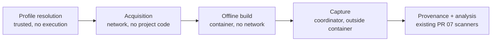

# Sentinel isolated Java build — design for review (PR 29)

**Status: design for the review [PR 29](implementation-prs.md#pr-29--optional-isolated-java-builds) requires
before implementation.** This document is not an implementation, does not admit any build, and does not move
PR 29 in the [progress ledger](execution-progress.md). Nothing here has been executed. Every default below is a
proposal until the review accepts it; every open point is listed in [§11](#11-unresolved-decisions).

It builds on the reviewed PR 03 store (ledger, staging, verified objects, retained roots) and on the PR 02/07
contracts (`WorkEnvelope`, `AttemptEnvelope` with an `owned-container` worker, `ResourcePolicy`, the worker
protocol's `ResultMessage`). **It changes neither.** Everything new is either a new PR 29 module or a new
canonical-JSON artifact with its own draft schema, stored through the existing object API.

## 1. What the build track adds, and what it never does

Source-only stays the default and the release behaviour. An owner may opt one source into an **isolated Java build
profile**. Sentinel then compiles that source's captured snapshot in a Linux container. It has no network, no host
credentials and no host configuration. The build produces generated sources and bytecode that no source-only scan
can see. Sentinel captures those outputs as new artifacts, ties each one to the snapshot and the build that produced
it, and recomputes capability and coverage for them.

Never, under any setting:

- run Maven, Gradle, a wrapper (`mvnw`, `gradlew`), a build script or a plugin on the host;
- fall back to host execution when the container backend is missing, unqualified or failing;
- give the build container network access, a host credential, a host home directory, a host Maven/Gradle
  configuration, the Docker socket or any host path other than the directories Sentinel materialises for it;
- run project code during **acquisition**, which is the only network-capable step;
- run tests, `package`, `install`, `deploy`, `exec`, application start-up or anything past the compile goals;
- treat a build's exit code, its log or its class files as evidence that something is protected;
- build an arbitrary repository, external benchmark or production target as part of developing or
  demonstrating this track (§2).

## 2. Target identity and scope

| Item | Identity |
|---|---|
| **First real demonstration target** | Only the **original Java/Spring Boot sample** written in this repository for the release gate ([progress ledger, end gates](execution-progress.md#end-gates-before-release)). It is identified by the Sentinel snapshot ID and tree digest of its capture, never by a path or a branch name. The profile and the approval receipt bind to that snapshot. That sample does not exist yet; its location is set when it is written. |
| **Test targets during implementation** | Synthetic fixtures authored in this repository for PR 29: one minimal well-behaved Maven project, one minimal Gradle project, and the adversarial fixtures of [§8](#8-adversarial-cases). Each is harmless by construction: canaries target TEST-NET addresses and a local listener the test owns, and nothing destructive is run. |
| **Not a target** | `examples/spring-invoice-api` stays a parse-only fixture. It has no dependency lock and was never written to be built. Using it would need the owner's explicit choice (§11, U9). Arbitrary repositories, other checkouts, external benchmarks and the reference application are never targets. |
| **Hosts** | Proposed: macOS ARM64 with Docker Desktop, the only host/backend combination PR 01 measured and the owner accepted. Linux x64 CI is a *candidate* until the isolation job proves it, the same rule PR 03 applies to SQLite pairs. Others are unqualified and refused. |
| **Build tools** | Maven first. Gradle only after its own offline evidence (§11, U2). Kotlin, Android, Bazel, sbt and Ant are out of scope. |

## 3. Three kinds of authority, kept apart

PR 29 needs three distinct permissions. None of them stands in for another.

1. **Implementation authorization.** The owner has authorised the whole backlog, including writing PR 29's code.
   That covers writing modules, synthetic fixtures and tests, and running those tests against the synthetic
   fixtures under the isolation job. It **does not** admit a build of any real source, an acquisition from a public
   repository, or a profile for any repository.
2. **Profile approval receipt** (a user action, per profile and per snapshot). The owner approves one build
   profile for one captured source. The receipt reuses the PR 06 preview → `--confirm` mechanism and its policy
   matcher (`decideGrants`). It is created only by the owner CLI on an interactive terminal, and binds:
   - store ID, source ID, snapshot ID and tree digest;
   - profile digest, toolchain lock digest, dependency lock digest and build image digest;
   - the goal list, resource budgets, an expiry and the actor (`who: human`, a local TTY confirmation).

   The receipt lives in owner state outside the checkout (`$XDG_STATE_HOME/farsight/sentinel/trust/`, as PR 06
   plans for settings adoption). The ledger records its digest, never its secret parts. Changed bytes in any bound
   input revoke it.
3. **Acquisition receipt** (a separate user action). Fetching the toolchain image and the dependency artifacts is
   the only network contact. It needs its own receipt, bound to the exact list of image digests, coordinates and
   SHA-256 values, the allowed repository URLs and a byte budget. A profile receipt never implies acquisition,
   and acquisition never implies a build.

**Agents cannot mint human approval.** MCP, the HTTP bridge, model review and any agent session can at most
*propose* a profile, using the existing decision-proposal flow. They cannot assert `who: human`, create or confirm
a receipt, extend one to another snapshot or repository, or approve their own proposal. A repository file
(`.farsight/sentinel/*`, `pom.xml`, `.mvn/*`, a Gradle script) can never authorise itself: the profile comes from
owner settings and is adopted by digest. Test code uses a **test-only receipt seam**. It builds receipts only inside
a temporary owner-state directory it owns, and ships in no production entry point. A test proves the production
CLI refuses a seam-made receipt.

## 4. Threat model

**Adversary.** The repository being built, and any dependency it names. Arbitrary code runs in the build JVM
through many routes:
- plugins and Maven extensions (`<extensions>true</extensions>`, `.mvn/extensions.xml`);
- `.mvn/jvm.config` and `.mvn/maven.config`;
- annotation processors, compiler plugins and source generators;
- Gradle settings, build and init scripts, and included builds;
- a compromised dependency jar.

This track assumes all of these run. **Containment, not prevention, is the defence.**

**Assets.** Host credentials and configuration (SSH keys, `~/.m2/settings.xml`, `~/.gradle`, cloud and npm tokens,
keychain, environment variables), the Docker socket, other repositories, the Sentinel store and its ledger, other
attempts' scratch space and outputs, and the integrity of provenance.

| Goal the adversary pursues | Control | Residual |
|---|---|---|
| Exfiltrate over the network | `--network none`; acquisition is a separate step that runs no project code | DNS and loopback inside the container namespace only |
| Read host files or credentials | No host mounts except Sentinel-materialised, read-only snapshot and dependency directories. `HOME`, `TMPDIR` and `MAVEN_USER_HOME`/`GRADLE_USER_HOME` point into scratch. The environment is an explicit allowlist. Sentinel generates `settings.xml` with no servers or credentials. | Anything already in the materialised snapshot is readable by design |
| Persist or poison later builds | Scratch is discarded per attempt. The dependency directory is read-only, re-materialised from content-addressed objects and verified each time. No shared build cache, Gradle daemon or local repository survives. | — |
| Escape the container | Non-root UID, read-only root filesystem, `--cap-drop ALL`, `no-new-privileges`, the default seccomp profile, no Docker socket, no privileged mode or devices, pinned image digest | Kernel or runtime vulnerabilities and Docker Desktop VM compromise are out of scope and stated as residual |
| Exhaust the host | PID, memory/swap and CPU limits, a bounded tmpfs scratch, a bounded output volume, a deadline, bounded logs | Docker Desktop VM headroom (PR 01's 512 MiB admission margin) |
| Forge or confuse provenance | The coordinator outside the container hashes every output. Paths are validated, and symlinks and special files refused. Build records are written by the coordinator, not the build. Bytecode-to-source mapping (`SourceFile`, debug tables) is recorded as an *attacker-controlled claim*. | A malicious build can emit misleading code. Its findings are labelled build-derived and never clear a source finding. |
| Tamper with Sentinel's store | The container never sees the store, the ledger or the object directory, only copies Sentinel materialised | Same-OS-account compromise is outside the boundary (PR 03) |
| Abuse a later scanner | Captured outputs are inputs to the existing PR 07 scanner isolation, never executed by Sentinel | — |

## 5. Phases

### P0 — profile resolution (no execution)

Sentinel reads the owner's adopted profile (§6) and the captured snapshot. It then inspects build files
**statically only**:
- the build tool and wrapper metadata, read as a hint and never executed;
- the declared Java release;
- the presence of `.mvn/extensions.xml`, `.mvn/*.config`, Gradle init and settings scripts, and plugin
  declarations.

Each of these becomes a recorded fact in the build record. Sentinel computes the profile digest, the toolchain
lock digest and the dependency lock digest, and checks the profile receipt against all of them. Any missing or
mismatched input refuses admission with a stable reason code, and the run reports *build unavailable*. This phase
runs no build tool and contacts no network.

### P1 — acquisition (network, never project code)

Acquisition fetches **only explicit coordinates with expected SHA-256 values**:
- the build image, by digest;
- the JDK and the Maven/Gradle distribution, if they are not inside the image;
- every dependency, parent POM, plugin and plugin dependency the dependency lock lists.

It uses Sentinel's own fetcher, from repository URLs on the acquisition receipt's allowlist (proposed: Maven
Central only). It **never** runs `mvn dependency:go-offline`, Gradle resolution or any build logic, because computing
the closure that way executes project code with network access. Each fetched file is verified against its expected
digest and stored as a Sentinel object. An acquisition manifest artifact lists coordinate → artifact ID.
Something the lock does not list is never fetched; if the offline build then lacks it, the build fails and the
result is *build failed: missing dependency*, never a retry with network.

**Where the dependency lock comes from is the central open question (§11, U1).** For the original sample, the
lock is written with the sample and reviewed with it, so the demonstration does not depend on solving it in general.

### P2 — offline build (container, no network)

The run is a work unit with stage contract `sentinel.stage.javaBuild`, kind `external-tool`, supervised as a
PR 07 `owned-container` attempt with ownership labels (store, attempt, epoch). The coordinator materialises
three directories under its own runtime area, each owned by Sentinel and created fresh per attempt:
- the snapshot source, from captured objects and never from the live checkout, read-only;
- the dependency repository, from acquisition objects, verified, read-only;
- a bounded writable scratch and output volume.

The container runs the pinned image as a non-root UID with every control in §4. The command is fixed by the profile
from an allowlist, never taken from the repository:

| Tool | Command shape (proposed) |
|---|---|
| Maven | `mvn --offline --batch-mode --no-transfer-progress -s /sentinel/settings.xml -Dmaven.repo.local=/deps <goals>` with goals from `{generate-sources, compile, test-compile}` |
| Gradle (later, U2) | `gradle --offline --no-daemon --no-build-cache --init-script /sentinel/init.gradle -g /scratch/gradle <tasks>` with tasks from an allowlist; the repository's `gradlew` and wrapper jar are never executed |

The environment is an explicit allowlist: `HOME`, `TMPDIR`, `JAVA_HOME`, `LANG`, `MAVEN_OPTS`/`JAVA_TOOL_OPTIONS`
set by Sentinel, and nothing inherited from the host. Project files such as `.mvn/maven.config` and `jvm.config`
still apply inside the container, because they are part of the build logic being contained. A test records their
effect (§8).

### P3 — capture (coordinator, outside the container)

After the container exits or is killed, the coordinator reads the output volume:
- generated sources (for example `target/generated-sources/**`, `build/generated/**`);
- class files;
- bounded build logs (stdout and stderr captured separately, each truncated at its budget with the truncation
  recorded);
- a full listing.

It refuses symlinks, hard links, devices, FIFOs, sockets, absolute or `..` paths, non-UTF-8 names it cannot
represent and anything past the file-count or byte budgets. Each refusal becomes a scoped reason, not a silent skip.
Each accepted file is staged, written through `objects.put()` and published with the attempt (PR 03 flow).
Over budget means *partial*, with the uncaptured scope named.

### P4 — provenance and analysis

The coordinator writes a **build record** (canonical JSON, draft schema `sentinel-java-build-record/draft-1`)
and publishes it with the outputs. It contains:
- snapshot ID and tree digest, profile digest, receipt digest, image digest;
- toolchain lock digest, dependency lock and acquisition manifest artifact IDs;
- the exact argv and environment;
- container ID and labels, resource policy, start and end, exit status and kill reason;
- the outputs manifest (relative path → artifact ID, plus the tool's own path class: generated source, class
  file, resource);
- log artifact IDs, refusals and the static facts from P0.

Later stages consume outputs **only through the build record**. A generated-source or bytecode observation cites
the build record artifact, the output path, the output artifact ID and the run's snapshot. Capability and coverage
are recomputed for build-derived scope **only when** `buildRecord.snapshotId` and tree digest equal the run's
snapshot. A mismatch, a missing record or a record failing validation makes that scope *unknown*, never covered.
Bytecode findings are labelled build-derived in both registers; their source mapping is shown as the class file's
claim.

## 6. New artifacts (draft, additive, stored as objects)

None of these is a ledger envelope kind and none changes `ENVELOPES`. Each is canonical JSON stored with
`objects.putCanonicalJson()`, carrying its own `schema` string and validated by PR 29's own validator before staging.

| Artifact | Schema (draft) | Privacy (PR 03 class) | Notes |
|---|---|---|---|
| Build profile | `sentinel-java-build-profile/draft-1` | `metadata` | Tool, tool version, image digest, goals, budgets, allowed static facts; adopted from owner settings by digest |
| Toolchain lock | `sentinel-java-toolchain-lock/draft-1` | `metadata` | Image digest, JDK and tool distribution digests |
| Dependency lock | `sentinel-java-dependency-lock/draft-1` | `source-derived` | Coordinates and SHA-256 values; which libraries a private project uses is treated as sensitive |
| Acquisition manifest | `sentinel-java-acquisition/draft-1` | `source-derived` | Coordinate → artifact ID, source URL, fetch time, receipt digest |
| Build record | `sentinel-java-build-record/draft-1` | `source-derived` | §5 P4 |
| Generated source | `text/x-java-source` and others by type | `source` | Derived from, and as sensitive as, source |
| Class file / resource | `application/java-vm` and others | `source` | Decompilable, so treated as source |
| Build log | `text/plain` | `source-derived` | May quote source; never exported in a redacted profile |
| Dependency jar | `application/java-archive` | `metadata` | Public third-party bytes; the *set* is covered by the dependency lock's class |

All of these become retained roots through the existing publication path. Retention stays as the plan says: no
automatic deletion, explicit pin and prune only (PR 26). A single object is capped at 16 MiB decoded by PR 03; a
larger jar or class archive cannot be stored without a later store change (§11, U4).

## 7. Budgets, crash cleanup and storage

**Budgets.** Proposed defaults, to be measured on the sample before acceptance:

| Resource | Proposal | Constraint |
|---|---|---|
| Deadline | ≤ 120 s | `ResourcePolicy.deadlineMs` caps at 120000 (PR 02). A longer build needs a reviewed contract revision (U3). |
| Memory and swap | ≤ 2 GiB | `ResourcePolicy.memoryBytes` cap; JVM heap set by Sentinel below it |
| CPUs | ≤ 2 | Contract cap |
| PIDs | ≤ 128 | Contract cap; Maven and javac fork |
| Scratch tmpfs | 256 MiB, `noexec` where the tool allows | PR 01 default; JVM JIT and native libraries may need `exec` (U5) |
| Output volume | 256 MiB, ≤ 20,000 files, ≤ 16 MiB per file | Captured beyond this means partial |
| Log capture | 4 MiB per stream | `maxOutputBytes` cap |
| Acquisition | Byte budget on the receipt; per-file ≤ 16 MiB | Store object cap |
| Concurrency | One build at a time, counted against PR 01's one-scanner concurrency | |

**Crash cleanup** follows PR 07/08 ownership:
- Each container carries labels (store ID, attempt ID, epoch, a random build nonce) recorded on the attempt
  before start.
- Materialised directories sit under a Sentinel-owned runtime directory named by attempt ID.
- On restart, recovery lists only containers whose labels exactly match a recorded attempt of this store. It
  stops and removes them and verifies they are absent. It then removes only the recorded attempt directories,
  after verifying their identity (device and inode recorded at creation).
- It never matches by name or command pattern, and never touches an unrelated container or path.
- A crash during capture leaves the attempt *interrupted* with its staging pins in place until aborted.
- No accepted reference can point at an uncaptured file (PR 03 guarantee).
- An unprovable cleanup leaves the attempt blocked and explained, never retried over a live container.

**Storage privacy.** The build container never sees the store. Materialised copies are created 0700/0600 and
removed after the attempt. Logs and generated outputs are `source` or `source-derived`, so redacted exports
exclude them (PR 19/26 profiles).

## 8. Adversarial cases

Each case is a synthetic fixture with a harmless canary and an expected recorded outcome. All must pass in the
isolation job on each host claimed as qualified.

| # | Fixture behaviour (in a plugin, extension, processor or build script) | Expected outcome |
|---|---|---|
| A1 | HTTP, raw TCP and DNS to a TEST-NET address and to a test-owned listener on the host | No connection; the listener records nothing; the build record holds the failure |
| A2 | Reads `~/.m2/settings.xml`, `~/.ssh`, `~/.gradle`, `/var/run/docker.sock` and dumps the environment | Paths absent or empty scratch copies; environment equals the allowlist; nothing host-specific in outputs or logs |
| A3 | Writes outside scratch (snapshot, dependency directory, root filesystem) | `EROFS`/`EACCES`; snapshot and dependency digests unchanged afterwards |
| A4 | Fork bomb, memory bomb, disk fill, infinite loop | PID limit, OOM kill, tmpfs `ENOSPC`, deadline kill: each recorded with its kind; the host stays responsive |
| A5 | Floods stdout and stderr | Each stream truncated at its budget, truncation recorded |
| A6 | Emits a symlink to `/etc/passwd` or the host, a FIFO, a `..` path, 100,000 files, a 20 MiB file | Each refused or partial with a scoped reason; nothing outside the output volume captured |
| A7 | Poisons the local repository or a cache for the next build | The next attempt re-materialises verified dependencies; poison absent |
| A8 | Repository ships `mvnw`/`gradlew` with a wrapper jar, `.mvn/extensions.xml`, `.mvn/maven.config` adding `--settings` or a remote repository | Wrapper never executed (static fact recorded); extension runs only inside the container; offline still holds; the effect of `maven.config` on Sentinel's `-s` is measured and recorded (U6) |
| A9 | Class files whose `SourceFile` or debug info names files that do not exist, or other packages | Mapping shown as a build claim; no source finding cleared or moved |
| A10 | The checkout changes after capture | The build uses the materialised snapshot; the build record's snapshot equals the run's; the live checkout is never read |
| A11 | Receipt tampering: another snapshot, a changed profile byte, an expired receipt, a test-seam receipt in production | Admission refused with a reason before any container is created |
| A12 | Kill the coordinator during build and during capture | Recovery removes exactly the labelled container and recorded directories; attempt interrupted; no dangling accepted reference |
| A13 | Container backend unavailable or unqualified | Build unavailable; no host execution; source-only results unaffected |

## 9. Acceptance matrix

| Requirement | Test | Pass criterion | Host scope |
|---|---|---|---|
| Source-only default unchanged | Existing source-only suites with no profile | Identical results and no container created | All |
| Authority separation | Unit tests on receipt binding, plus a production CLI with a seam receipt | Each bound field change revokes; seam receipt refused; no agent path can create or confirm | All |
| Acquisition runs no project code | Acquisition against a local file-based fake repository; an extension fixture that would beacon if executed | Only listed coordinates fetched and verified; beacon silent | All |
| Offline build containment | A1–A8, A13 | As in §8 | Each qualified host |
| Capture safety | A6, A9 | As in §8 | Each qualified host |
| Provenance completeness | Each output carries build record → snapshot → profile → receipt → image → dependency lock; a mismatch makes scope unknown | Complete chain validated by the PR 29 validator; mismatch → unknown | All |
| Crash cleanup | A12 (20 repetitions per boundary, matching PR 08) | Zero orphaned labelled containers or directories; zero unrelated containers touched | Each qualified host |
| Budgets | A4, plus the sample within the proposed limits | Every limit hit records its kind; the sample completes within budget or the budget decision is escalated (U3) | macOS ARM64 measured; Linux x64 candidate |
| First real demonstration | The original sample: profile adopted by the owner, acquisition receipt, build, capture, scan | Generated or bytecode scope appears with complete provenance; a build-only finding is shown as build-derived; nothing changes source-only verdicts | macOS ARM64 |
| Reporting | Report shows build-derived scope, its provenance and its unknowns in both registers | Standalone report readable offline; build log content absent from redacted export | All |

## 10. Implementation sequence

Each step is its own reviewable commit or PR. It builds only synthetic fixtures until 29g.

| Step | Content | Targets |
|---|---|---|
| 29.0 | This design review: the owner and SOL accept, amend or reject §11 decisions | — |
| 29a | Draft schemas and validators for §6 artifacts; receipt verification against owner state; test-only receipt seam; no execution | Unit fixtures only |
| 29b | Acquisition fetcher: explicit coordinates and SHA-256 values, URL allowlist, verified storage, acquisition manifest; tested against a local file repository | Local fake repository; no public network in tests |
| 29c | Offline build runner on PR 07 isolation: materialisation, fixed argv, environment allowlist, Sentinel `settings.xml`, labels, budgets | Minimal well-behaved synthetic Maven fixture |
| 29d | Capture and provenance: output walk, refusals, staging and publish, build record | Same fixture |
| 29e | Adversarial matrix A1–A13 in the isolation CI job; crash-cleanup repetitions | Synthetic adversarial fixtures |
| 29f | Generated-source and bytecode adapters into the existing scanners; coverage recomputation gated on the build record | Synthetic fixtures |
| 29g | First real demonstration: the original sample, owner profile receipt and acquisition receipt as **user actions** recorded in the progress ledger | Only the original sample's captured snapshot |
| 29h | Report and docs: build-derived labels, unknowns, operator setup; progress row updated only with merged evidence | — |

## 11. Unresolved decisions

These are candid gaps. Each needs a decision or evidence at review, not an assumption during implementation.

- **U1 — where a complete dependency lock comes from.** A Maven or Gradle closure cannot be computed by running
  the build tool without executing project code with network. Options:
  - (a) the owner supplies the lock, produced outside Sentinel's boundary at their own risk;
  - (b) a Sentinel-owned resolver computes it from static POMs and parent POMs only. This fails for profiles,
    extensions, plugin-dependent models and every Gradle build;
  - (c) a later discovery mode in an egress-filtered container. This means project code with network, and is
    rejected for this track unless separately reviewed.

  Proposed: (a) for real sources and a hand-reviewed lock for the original sample. No general solution is
  claimed.
- **U2 — Gradle.** Gradle configuration is code (`settings.gradle(.kts)`, included builds), and offline mode
  needs a complete artifact set including Gradle's own plugin portal artifacts. Proposed: Maven only until a
  synthetic Gradle fixture passes A1–A13 and has a lock source under U1.
- **U3 — budgets versus the contract.** PR 02's `ResourcePolicy` caps the deadline at 120 s and memory at 2 GiB. A
  Spring build may exceed this, especially on a cold JVM. If the sample does not fit, either a reviewed draft
  contract revision raises the caps for this stage kind, or the build reports *budget exceeded*. Nothing changes
  PR 02 now.
- **U4 — objects over 16 MiB.** Some jars and class archives exceed PR 03's decoded object cap. Options: refuse with
  a reason (proposed for v1), or a later reviewed store change for chunked objects.
- **U5 — `noexec` scratch.** JVM tooling may need executable temporary files (native libraries, JIT). Whether
  `noexec` holds is measured per tool; a change is recorded as a profile fact.
- **U6 — project-controlled Maven configuration.** The precedence of `.mvn/maven.config` and `.mvn/jvm.config` over
  Sentinel's flags is to be measured (A8). Offline and no-network hold regardless, but recorded argv may not be the
  effective argv. The build record must say which.
- **U7 — build image provenance.** Options are an upstream image pinned by digest, or a Sentinel-built image from
  a pinned Dockerfile, which needs its own acquisition receipt. Licence and SBOM recording for the image are
  required either way. Undecided.
- **U8 — Linux qualification.** Linux x64 CI and Linux hosts are candidates only until the isolation job's evidence
  exists, mirroring PR 03's exact-pair policy.
- **U9 — the existing `examples/spring-invoice-api`.** It is parse-only and has no lock. Using it as a build
  target is the owner's choice. This design assumes no.
- **U10 — bytecode-only finding policy.** Proposed: such a finding is reported but never upgrades or clears a
  source verdict. Whether a build-derived finding can fail CI policy (exit 1) is an owner policy decision.
- **U11 — what the receipt UI looks like.** The PR 06 CLI flow is the mechanism. Whether the GUI may host profile
  approval is deferred to the same owner-control rule as other approvals (implementation plan §11).

## 12. What this document does not authorise

It does not:
- authorise any build, any acquisition or any container run against a real source;
- create a profile or receipt for any repository;
- change PR 02, 03 or 07 contracts or code;
- mark PR 29 started or done.

Review outcomes are recorded by the integration lead. User actions (profile adoption, acquisition approval) are
recorded as such in the progress ledger when they happen.
