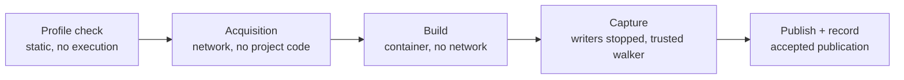

# Sentinel isolated Java build — design for review (PR 29)

**Status: design for the review [PR 29](implementation-prs.md#pr-29--optional-isolated-java-builds) requires
before implementation, revision 2.** It addresses the first SOL review's five blocking findings and adopts the
integration lead's accepted defaults (§2). It is not an implementation, admits no build, and does not move PR 29
in the [progress ledger](execution-progress.md). Nothing here has been executed. What remains open is in
[§12](#12-remaining-decisions-and-measurements).

It builds on the reviewed PR 03 store (ledger, staging, verified objects, retained roots, the 16 MiB object cap,
4096 staged artifacts per stage) and on the PR 02/07 contracts:
- `WorkEnvelope` with `dependencies`;
- `AttemptEnvelope` with an `owned-container` worker and at most 1024 `outputs`;
- `ResourcePolicy` with its 120 s and 2 GiB caps;
- the worker protocol's `ResultMessage`.

**It changes no PR 02/07 contract, no ledger schema or migration, and no existing PR 03 API or behaviour.** Everything
new is a PR 29 module or a canonical-JSON artifact with its own draft schema, stored through the existing object
API. The one addition to PR 03 code is two **bounded, read-only** ledger queries the provenance check needs (§6.1).
They add no table, column, write path or raw database access.

## 1. What the build track adds, and what it never does

Source-only stays the default and the release behaviour. An approved build scope (§3) lets Sentinel compile one
captured snapshot with Maven in a Linux container. The container has no network, no host credentials and no host
configuration. Sentinel captures the build's outputs (generated sources, class files, resources) as artifacts, ties
each one to the accepted build publication (§6), and recomputes capability and coverage for them.

Never, under any setting:

- run Maven, a wrapper (`mvnw`), a build script or a plugin on the host;
- fall back to host execution when the container backend is missing, unqualified or failing;
- give the build container network access, a host credential, a host home directory, host Maven configuration,
  the Docker socket or any host path other than what Sentinel prepares for it;
- run project code during **acquisition**, the only network-capable step;
- treat a build's exit code, log or class files as evidence that anything is protected;
- build an arbitrary repository, external benchmark or production target while developing or demonstrating
  this track (§2).

**Requested is not the same as executed.** Sentinel invokes only the phases the approved scope names. It cannot
promise what runs inside them. Plugins bound to those phases, core extensions loaded when the project model is
built, and annotation processors are arbitrary code. They can run tests, fork processes, start servers or
reproduce any other phase's behaviour. The track **contains** that behaviour (§4, §5); it does not prevent it. The
build record says *requested phases*, never *what ran*.

## 2. Scope and accepted defaults

| Item | Decision |
|---|---|
| Build tool | **Maven only.** Gradle is *unavailable* until an independent gate passes its own offline, closure and adversarial evidence. A Gradle build reports `sentinel.reason.buildToolUnsupported`. |
| First real demonstration target | Only the **original Java/Spring Boot sample** written in this repository for the release gate ([end gates](execution-progress.md#end-gates-before-release)). It is identified by the Sentinel snapshot ID and tree digest of its capture, never by a path or branch. The sample does not exist yet; its location is fixed when it is written. |
| Test targets during implementation | Synthetic fixtures authored for PR 29: one minimal well-behaved Maven project, one multi-module project, and the adversarial fixtures of §9. Canaries target TEST-NET addresses and a listener the test owns. |
| Not targets | `examples/spring-invoice-api` (a parse-only fixture with no closure), arbitrary repositories, other checkouts, external benchmarks and the reference application. |
| Dependency closure | A **hand-reviewed, complete closure** for the original sample. It includes every artifact Maven reads from an *empty* local repository: parent POMs, imported BOMs, plugins and their dependencies, core extensions, and the repository metadata Maven consults offline. Each entry is a coordinate, file name and SHA-256 value. §5 P1 describes how it is assembled without running project code. |
| Acquisition | Sentinel's own fetcher, explicit coordinates only, from the registry policy below. **No project code runs during acquisition.** |
| Image | One pinned image containing a JDK and Maven, identified by digest. Registry policy: the image is pulled by digest from one named registry, and dependencies are fetched from Maven Central over HTTPS only. Nothing else is contacted. |
| Budgets | The existing `ResourcePolicy` caps: 120 s deadline and 2 GiB memory/swap, with 2 CPUs and 128 PIDs. They are measured on the sample later; a build that does not fit reports *budget exceeded*. No contract increase is proposed. |
| Bytecode mappings | `SourceFile`, debug tables and any class → source mapping are **untrusted claims** from the build. |
| Hosts | macOS ARM64 with Docker Desktop is the measured combination. Linux x64 CI is a *candidate* until the isolation job proves it, mirroring PR 03's exact-pair policy. |

## 3. Authorization: what exists now, what the product requires later

**Current authorization, recorded once and bounded.** The owner explicitly authorised finishing the whole backlog,
including PR 29. The progress ledger scopes real build testing to the original synthetic fixtures and the local
sample application. The implementation plan (§11) lets an owner **preauthorize a bounded run or profile**. Together
these already cover:
- building the synthetic fixtures;
- building the original sample under the approved profile;
- acquiring that sample's pinned image and hand-reviewed closure.

No fresh terminal confirmation and no repeated permission request are required for these. The scope is recorded
as one **bounded authorization record** (draft schema `sentinel-build-authorization/draft-1`) with truthful
provenance:

| Field | Value |
|---|---|
| `basis` | `owner-preauthorization`, citing the owner direction recorded in the progress ledger by date |
| `actor` | `{ kind: 'delegated-agent', recordedBy: <integration lead session>, onBehalfOf: 'owner' }`. Never `who: human`, and never presented as a human receipt. |
| `scope.targets` | Exact snapshot IDs and tree digests: the synthetic fixtures' and, once captured, the original sample's |
| `scope.profile` | The profile digest (§6) |
| `scope.image` | The image digest and its registry |
| `scope.closure` | The closure lock digest, and its byte and file counts |
| `scope.registries` | The registry policy of §2 |
| `scope.budgets` | The `ResourcePolicy` values and the capture limits of §7 |
| `limits` | No other target, profile, image, closure or registry; it expires with PR 29's release gate |

The admission check accepts a build only if every bound field equals the request. Any other target, a changed
profile byte, another image or a closure change is outside the record and refused. Extending the scope means a new
record from the integration lead, citing the owner's direction for it.

**Product behaviour for everyone else (later users, arbitrary repositories).** Building any other source needs a
**human receipt**. It uses the PR 06 preview → `--confirm` flow and `decideGrants`, is created only by the owner CLI
at an interactive terminal, carries `who: human`, and binds the same scope fields. It lives in owner state outside
the checkout (`$XDG_STATE_HOME/farsight/sentinel/trust/`). Acquisition for such a source is a separate receipt over
exact coordinates and SHA-256 values. **Agents cannot mint a human receipt.** MCP, the HTTP bridge, model review and
agent sessions can only *propose* a profile through the existing decision-proposal flow. A repository file
(`.farsight/sentinel/*`, `pom.xml`, `.mvn/*`) never authorises itself.

Tests use a **test-only seam** that writes receipts and authorization records into a temporary owner-state
directory. A test proves the production CLI refuses anything the seam made. The current delegated record is
written by the integration lead outside any test seam, and is never labelled human.

## 4. Threat model

**Adversary.** The repository being built and every artifact in its closure. Arbitrary code runs in the build JVM
through many routes:
- core extensions in `.mvn/extensions.xml`, loaded while the model is being built, before any requested phase;
- build extensions (`<extensions>true</extensions>`);
- plugins bound to the requested phases;
- annotation processors and compiler plugins;
- `.mvn/jvm.config` (for example a `-javaagent`);
- `.mvn/maven.config` (extra command-line arguments);
- a compromised closure artifact.

**Assets.** Host credentials and configuration (SSH keys, `~/.m2`, cloud and npm tokens, keychain, environment),
the Docker socket, other repositories, the Sentinel store and ledger, other attempts' workspaces, and the
integrity of provenance.

| Goal the adversary pursues | Control | Residual |
|---|---|---|
| Exfiltrate | `--network none`; acquisition runs no project code | Loopback inside the container's own namespace |
| Read host files or credentials | Only a read-only source copy, a read-only closure and Sentinel-created volumes are mounted. `HOME` and `TMPDIR` are on scratch; the environment is an explicit allowlist; Sentinel generates `settings.xml` with no servers or credentials. | Whatever is in the snapshot itself |
| Persist or poison later builds | Workspace, scratch and the Maven local head repository are fresh per attempt and discarded. The closure tail is read-only and verified before each mount. There is no daemon or shared cache. | — |
| Escape the container | Non-root UID, read-only root filesystem, `--cap-drop ALL`, `no-new-privileges`, default seccomp, no Docker socket, no privileged mode or devices, pinned image digest | Kernel, runtime or Docker Desktop VM vulnerabilities (stated residual) |
| Exhaust the host | `ResourcePolicy` limits; size-limited tmpfs volumes (§5 P2), whose pages are also charged to the container's memory; deadline; bounded logs | Docker Desktop VM headroom (PR 01's 512 MiB admission margin) |
| Forge provenance | The coordinator writes the build record. A trusted capture step walks the outputs. Downstream trust comes only from the accepted publication (§6), never from a record's contents. | A malicious build can emit misleading code; its findings are labelled build-derived |
| Change Maven's behaviour by configuration | `.mvn/**` files are identity-bound into the profile (§5 P0). Effective arguments and JVM options are recorded. Flags that would defeat containment have no effect without network or host paths. | A bound `.mvn` file runs as approved code; it is still contained |

## 5. Phases

### P0 — profile check (static, no execution)

Sentinel compares the request with the authorization record or receipt. It then inspects the captured snapshot
statically:
- the Maven project root;
- every `pom.xml` in the reactor, read as data;
- the presence and SHA-256 of every file under `.mvn/`;
- wrapper files (`mvnw`, `.mvn/wrapper/*`), recorded as facts and never executed;
- a declared `maven.compiler.release` or `<release>`.

**`.mvn` policy.** `extensions.xml`, `maven.config` and `jvm.config` change what Maven does before and around the
requested phases, so they are bound by identity. The profile lists the exact relative path and SHA-256 of each
`.mvn/**` file it approves. Any file under `.mvn/` that the profile does not list is refused, as is a listed file
with different bytes (`sentinel.reason.buildConfigUnapproved`). The original sample is written with **no** `.mvn/`
files, so its profile approves none. A missing or mismatched input refuses admission, and that scope is reported
as *build unavailable*. No build tool runs and no network is used here.

### P1 — acquisition (network, never project code)

Two kinds of input, stored differently because the image exceeds the object cap:

- **The image** is pulled by digest from the policy's registry into Docker's runtime-managed image store. It is
  **not** a Sentinel object. Sentinel records the digest. Before every use it verifies with `docker image inspect`
  that the local image ID and repository digest match, and refuses otherwise; it never pulls at run time (PR 07).
  The image's JDK and Maven versions are measured once with trusted commands (`java -version`, `mvn -v`, no network)
  and recorded as toolchain facts. Removing or replacing the image makes later builds *build unavailable* until it
  is re-acquired within scope.
- **The closure.** Sentinel's fetcher downloads each listed coordinate from Maven Central over HTTPS, checks
  SHA-256 against the closure lock, and stores the file as a Sentinel object. Any file larger than 16 MiB is refused,
  which makes that closure unsupported; no such file is expected in the sample's closure. An acquisition manifest
  maps coordinate → artifact ID.

**Assembling the sample's closure without project code.** The closure is reviewed by hand and completed
iteratively:
1. Write the lock from the sample's declared parent, BOMs, dependencies, plugins and their known transitive
   requirements.
2. Acquire it.
3. Run the offline build (P2) from an **empty** local head repository with the closure as its only tail.
4. Every missing-artifact failure names a coordinate. Review that coordinate, add it, acquire it and repeat.

The closure is complete when the offline build from an empty cache succeeds. The final lock and its acquisition
manifest are reviewed with the sample. At no point does Maven run with network.

Residual: the integrity of the first fetch rests on HTTPS to Maven Central. Where Central publishes a checksum, it
is compared as well.

### P2 — build (container, no network)

**Writable layout.** Maven writes `target/` (or a configured `project.build.directory`) inside each module's base
directory, so a read-only source mount cannot build. The container therefore gets:

| Mount | Kind | Contents | Size limit |
|---|---|---|---|
| `/sentinel/src` | bind, read-only | The snapshot, materialised by the coordinator from captured objects (never the live checkout) | — |
| `/sentinel/closure` | bind, read-only | The verified closure laid out as a Maven repository | — |
| `/work` | named Docker volume, `local` driver, `type=tmpfs`, `o=size=<workspace>,uid=<build uid>,mode=0700` | Sentinel's trusted copy step copies `/sentinel/src` here first; the build runs in `/work` | Workspace quota (§7), a real tmpfs limit giving `ENOSPC`, not a bind directory |
| `/scratch` | container tmpfs with `size=` | `HOME`, `TMPDIR`, Maven's local **head** repository | Scratch quota (§7); discarded and never captured |
| root filesystem | read-only | The pinned image | — |

The `/work` volume outlives the container on purpose, so capture can read it after every writer has stopped (P3).
Because its pages are tmpfs, they count toward the VM's memory and, while the build writes them, the container's
memory cgroup. Both are measured on the sample (§12, M2).

**Command.** Inside the container, a trusted entry script from the image runs two steps in order:
1. the copy step;
2. `mvn --offline --batch-mode --no-transfer-progress -s /sentinel/settings.xml -Dmaven.repo.local=/scratch/m2
   -Dmaven.repo.local.tail=/sentinel/closure <requested phases>`.

The `maven.repo.local.tail` option of Maven 3.9 keeps the closure read-only and puts Maven's tracking files in the
head repository. Whether the image's Maven honours it read-only is measurement M1. The requested phases come only
from the approved profile. Proposed: `compile` for the sample, or `test-compile` when its tests are part of the
analysed scope.

The environment is an explicit allowlist: `HOME`, `TMPDIR`, `JAVA_HOME`, `LANG`, and `MAVEN_OPTS` set by Sentinel.
Nothing is inherited from the host, and `MAVEN_ARGS` is unset.

**Effective configuration.** An approved `.mvn/maven.config` adds arguments, and an approved `.mvn/jvm.config` adds
JVM options. The entry script records:
- the exact argv it ran;
- the bytes of each approved `.mvn` file;
- Maven's own report of active settings and properties, from `help:effective-settings`. This is only if that plugin
  is in the closure, and it runs before the build in the same offline container.

The build record therefore shows the configured command, not only the requested one.

**Multi-module and custom output.**
- A reactor build writes under each module's directory inside `/work`; capture finds those writes by comparing
  `/work` with the source manifest.
- A custom `project.build.directory` or generated-sources directory inside `/work` is captured the same way.
- Writes outside `/work` either fail (read-only root filesystem and mounts) or land in `/scratch`, which is never
  captured. A build that relies on such a location produces *partial* coverage naming it.
- A build that **modifies a tracked source file** in `/work` is recorded as `modifiesSnapshotPath`. Sentinel
  captures the modified file as a build output, never as source.

### P3 — capture (writers stopped first)

1. **Stop every writer.** When the build process exits or the deadline passes, the coordinator stops and removes
   the build container by its recorded ID and labels. It then verifies the container is gone. No other container
   ever mounts `/work` read-write, so once it is gone nothing can write.
2. **Walk with a trusted capture container.** It runs the same pinned image under `--network none` with a read-only
   root and `/work` mounted **read-only**, and executes Sentinel's capture walker, not project code. The walker:
   - compares `/work` with the materialised source manifest;
   - refuses symlinks, hard links, devices, FIFOs, sockets, absolute or `..` paths and unrepresentable names;
   - emits a bounded stream: a listing of every new or changed path (path, size, mode, type), then the accepted
     files' bytes up to the capture limits of §7.
3. **Hash and stage outside the container.** The coordinator hashes each file, registers staging, writes the objects
   through `objects.put()` with `expect`, and keeps stdout and stderr logs (each bounded, with truncation recorded).
   Staging registers each **distinct** artifact ID once, however many paths or streams share its bytes (§7).
4. **Release the workspace.** The volume and every materialised host directory are removed only after publication
   or abort (§8).

### P4 — publish and record

The build is one work unit whose stage contract is `sentinel.stage.javaBuild`, kind `external-tool`, with a fixed
`implementationDigest` of Sentinel's build adapter. It publishes once, through the PR 03 flow (§7 lists the shape),
and its outputs include the **build record** (§6).

## 6. Trusting build outputs: the accepted publication, not the record's JSON

A build record that merely validates, or that names the right snapshot, proves nothing: any schema-valid JSON can
say that. A consumer trusts build-derived scope **only through this chain**, checked from the ledger:

1. The consumer's work unit lists the build as a dependency: `dependencies` contains `{ id, revision }` of a work
   unit whose stage is `sentinel.stage.javaBuild` with the expected `implementationDigest`.
2. That exact revision has an **accepted publication** in this store. Its attempt is the publication's attempt, and
   the attempt's final envelope is `succeeded`. The attempt's epoch equals the **epoch recorded on that
   publication**: the historical epoch under which it was accepted, not the current owner's. A build accepted
   before a restart stays valid after the store is reopened under a new epoch, without a rebuild. A later epoch
   cannot accept anything for that revision, because the revision already has its one publication.
3. The publication's ordered outputs are **exactly two**: the build record, then the outputs manifest. The record
   names the manifest's artifact ID, so the two cannot share bytes. Logs and files are not outputs; they are roles
   in the manifest (§7).
4. The build record's own fields equal the facts above:
   - work ID and revision, attempt ID;
   - snapshot ID and tree digest, equal to the consumer run's snapshot;
   - the authorization record or receipt digest, the profile digest, and the image digest with its toolchain facts;
   - the closure lock digest and the acquisition manifest artifact ID, equal to the authorization's bounded scope.
5. Every role in the outputs manifest names an artifact that is a reference **of that same publication**, reachable
   through the manifest's links. The roles are `stdout`, `stderr` and one entry per captured path. The publication
   has no reference the manifest does not account for, and `objects.check()` verifies each referenced object.

If any link fails, the build-derived scope is **unknown**, never covered. This includes:
- a record published by another work unit;
- a valid record copied into another publication;
- another revision;
- an attempt that was superseded;
- a manifest entry outside the publication;
- an object that fails verification.

Section 9's case A14 is a forged but schema-valid record, which must be refused. Bytecode findings are labelled
build-derived in both registers, and their source mapping is shown as the class file's claim.

### 6.1 Bounded reads the check needs

The integrated PR 03 ledger does not expose what checks 1, 2 and 5 read:
- `getWork` returns state and the active attempt, not the stored envelope's stage, implementation digest or
  dependencies;
- `getPublication` returns ordered outputs, not linked references or the publication's epoch.

PR 29 adds two read-only ledger methods. Like every ledger read, each runs in one read transaction; neither writes,
opens a connection to callers or accepts SQL.

| Method | Returns | Bounds and checks |
|---|---|---|
| `getWorkProvenance(ref: WorkRef)` | `{ work, runId, state, creationEpoch, stage: { contract, contractVersion, kind, implementationDigest }, inputFingerprint, influenceManifest, dependencies: WorkRef[] }`, or `null` | Parsed from the stored creation envelope after the same contract validation and row cross-checks GC rooting uses; a disagreement throws `sentinel.store.corruptRecord`. `dependencies` is at most 1024, the contract's own bound. |
| `getPublicationRefs(ref: WorkRef, { after?, limit? })` | `{ publication: { work, attemptId, epoch, sequence, resultDigest, acceptedAt }, refs: Array<{ artifactId, role: 'output' \| 'linked', position, schema, privacy }>, cursor, more }`, or `null` | Ordered by role, then position, then artifact ID. At most 500 refs per page, cursor-paged, and never more than the publication's own (≤ 4096) references. |

Both are additive: no existing method changes shape. They go into the store facade's `StoreLedger` pick list with
tests. A test checks that neither can return rows from another store or another publication.

## 7. Publication shape and supported limits

PR 03 accepts at most 4096 staged artifacts per stage, with **unique** IDs. A publication's references are unique per
artifact, and an attempt's envelope carries at most 1024 distinct `outputs`. Different roles can share bytes: two
empty logs, identical generated files, or a log that equals a file. So a build publishes a **deduplicated object
closure** and expresses roles in the outputs manifest:

| Publication part | Exact count | Role |
|---|---|---|
| Build record, outputs manifest | exactly **2** | `outputs`, in that order |
| Distinct artifacts behind the manifest's roles (stdout, stderr, every captured path) | ≤ **4,002** | `linked`, each linked once from the outputs manifest |
| Total staged (unique IDs) | ≤ **4,004** | under the 4096 stage limit |

The manifest maps each role to an artifact ID: `stdout`, `stderr`, and one entry per captured path with its size
and type. Several roles may name one ID, and that ID is staged, linked and referenced **once**. A role whose
artifact is also an output (for example, a captured file that happens to equal the manifest) uses the existing
reference. Budgets count **distinct artifacts** for the stage limit and **manifest path entries** for the file
limit, and each is enforced separately.

**Supported capture limits (v1):**
- **4,000 manifest path entries** (captured files), however many distinct objects they share;
- **16 MiB per file**;
- **256 MiB total captured bytes**;
- an outputs manifest of at most 16 MiB, which lists accepted files in full;
- for uncaptured paths: the first **10,000** paths with their sizes, then counts only.

Past any limit the build is published as **partial**, with every uncaptured path or counted remainder named as
uncovered scope. The limits are chosen to stay inside PR 03's limits without a contract change. The sample is
expected to need far fewer files (§12, M3).

| Resource | Value | Source |
|---|---|---|
| Deadline | 120 s | `ResourcePolicy.deadlineMs` cap |
| Memory and swap | 2 GiB, JVM heap set below it by Sentinel | `ResourcePolicy.memoryBytes` cap |
| CPUs and PIDs | 2 CPUs and 128 PIDs | Contract caps |
| `/work` workspace quota | 512 MiB (the source copy plus outputs) | tmpfs volume `size=` |
| `/scratch` quota | 256 MiB | container tmpfs `size=` |
| Logs | 4 MiB per stream | `maxOutputBytes` |
| Concurrency | One build at a time, counted against PR 01's one-scanner limit | — |

The two tmpfs quotas and the source copy share the VM's memory with the 2 GiB container limit. Admission checks the
VM headroom before creating the container (§12, M2).

## 8. Crash cleanup and storage privacy

**Ownership.** Each build container, capture container and `/work` volume carries labels: store ID, attempt ID,
epoch and a random build nonce. The labels are recorded on the attempt before anything is created. Materialised host
directories sit under a Sentinel-owned runtime directory named by attempt ID, with their device and inode recorded
at creation.

**Recovery.** On restart, recovery (PR 08):
- lists only containers and volumes whose labels exactly match a recorded attempt of this store;
- stops and removes them, then verifies they are absent;
- removes only recorded directories whose identity still matches.

It never matches by name or command pattern and never touches unrelated containers, volumes or paths. A crash
before publication leaves the attempt *interrupted*, with its staging pins in place until aborted. PR 03 guarantees
that no accepted reference names an uncaptured file. If cleanup cannot be proved, the attempt stays blocked with
the reason and is never retried over a live container.

**Privacy.** The containers never see the store.

| Artifact | PR 03 class | Note |
|---|---|---|
| Build authorization / profile | `metadata` | — |
| Closure lock, acquisition manifest, build record, outputs manifest | `source-derived` | Which libraries a private project uses is sensitive |
| Generated sources, class files, captured resources | `source` | Decompilable or source-equivalent |
| Build logs | `source-derived` | May quote source; excluded from redacted exports |
| Closure jars | `metadata` | Public third-party bytes |

Materialised host copies are created 0700/0600 and removed after the attempt. Retention follows the plan: no
automatic deletion, and explicit pin and prune (PR 26).

## 9. Adversarial cases

Each case is a synthetic fixture with a harmless canary and an expected recorded outcome. All must pass in the
isolation job on each host claimed as qualified.

| # | Fixture behaviour | Expected outcome |
|---|---|---|
| A1 | HTTP, raw TCP and DNS to a TEST-NET address and to a test-owned host listener, from a plugin in the requested phase | No connection; the listener records nothing |
| A2 | Reads `~/.m2/settings.xml`, `~/.ssh`, `/var/run/docker.sock`, and dumps the environment | Absent or empty scratch copies; environment equals the allowlist |
| A3 | Writes to `/sentinel/src`, `/sentinel/closure` and the root filesystem | `EROFS`/`EACCES`; source and closure digests unchanged |
| A4 | Fork bomb, memory bomb, filling `/work` and `/scratch`, infinite loop | PID limit, OOM kill, `ENOSPC` at each tmpfs quota, deadline kill, each recorded with its kind |
| A5 | Floods stdout and stderr | Each stream truncated at 4 MiB, truncation recorded |
| A6 | Emits a symlink to the host, a FIFO, a `..` path, 5,000 files, a 20 MiB file | Refused, or partial with named scope; nothing outside `/work` captured |
| A7 | Poisons the head repository or a cache for the next build | The next attempt starts from an empty head; poison absent |
| A8 | **Early phase:** a core extension in `.mvn/extensions.xml` beacons during model building | Refused at P0 unless the profile approves its digest; if approved, the beacon is contained (A1 outcome) |
| A9 | **Config:** `.mvn/maven.config` adds `-s`, `-Dmaven.repo.local=`, `-Dmaven.repo.local.tail=`, a remote repository or `-T 64`; `.mvn/jvm.config` adds `-javaagent` or a large `-Xmx` | Refused at P0 unless approved by digest. If approved, offline and mounts still hold, the recorded effective configuration shows the change, memory limits still apply. |
| A10 | **Phase escape:** a plugin bound to `compile` runs the project's tests, starts the application listening on a port, and forks an `exec` | Contained: no network and the limits hold; the build record still says *requested: compile*; any outputs produced are captured like any others |
| A11 | Writes outputs only to `/scratch` or a custom build directory outside `/work`; modifies a tracked source file | Scratch writes are not captured, and the build is partial with the reason; the modified tracked file is recorded as `modifiesSnapshotPath` |
| A12 | A background process keeps writing to `/work` after Maven exits | It is killed with the container before capture; capture sees a stable tree |
| A13 | Class files whose `SourceFile` or debug info names other files or packages | Shown as a build claim; no source finding cleared or moved |
| A14 | **Forged record:** a schema-valid build record naming the right snapshot, published by another work unit, copied into another publication, or naming another revision or a superseded attempt | Build-derived scope unknown in every variant |
| A15 | Authorization mismatch: another snapshot, a changed profile or closure byte, another image, an expired record, a seam-made record in production | Admission refused before any container is created |
| A16 | Kill the coordinator during build, during capture and before publish | Recovery removes exactly the labelled containers, volume and recorded directories; attempt interrupted; no dangling accepted reference |
| A17 | Container backend unavailable or unqualified, or image digest mismatch | Build unavailable; no host execution, no pull; source-only results unchanged |

## 10. Acceptance matrix

| Requirement | Test | Pass criterion | Host scope |
|---|---|---|---|
| Source-only unchanged | Existing source-only suites with no build scope | Identical results; no container or volume created | All |
| Authorization | A15; record and receipt binding unit tests; production CLI with seam records | Every bound field change refuses; seam records refused; no agent path creates a human receipt; the delegated record never claims `who: human` | All |
| Acquisition runs no project code | Fetcher against a local file-based fake repository; an extension fixture that would beacon if executed | Only listed coordinates fetched and verified; beacon silent | All |
| Closure completeness (sample) | Offline build from an empty head with only the closure tail | Succeeds; the lock and manifest match | macOS ARM64 |
| Containment | A1–A5, A7–A12, A17 | As in §9 | Each qualified host |
| Capture safety and limits | A6, A11, A12 | As in §9; limits of §7 enforced with named partial scope | Each qualified host |
| Provenance chain | A13, A14; §6 checks 1–5 on a good build | Good build trusted; every forged or mismatched variant unknown | All |
| Reopen without rebuild | Accept a build, close the store, reopen under a new epoch, run a consumer | Build-derived scope trusted through the publication's historical epoch; no rebuild; no new publication for that revision | All |
| Deduplicated closure | Empty stdout and stderr; identical files under two paths; a file equal to a log | One staged object and one reference per distinct ID; every role resolves; exactly two outputs; counts as in §7 | All |
| Bounded reads | `getWorkProvenance` and `getPublicationRefs` on good, corrupt, foreign-store and paged cases | Correct fields; corrupt record throws; no cross-store or cross-publication rows; pages bounded | All |
| Crash cleanup | A16 (20 repetitions per boundary, matching PR 08) | Zero orphaned labelled containers, volumes or directories; zero unrelated objects touched | Each qualified host |
| Budgets | A4, and the sample under §7 | Limits recorded by kind; the sample within the caps, else *budget exceeded* recorded and escalated | macOS ARM64 measured; Linux x64 candidate |
| First real demonstration | The original sample under its bounded authorization record | Build-derived scope with the complete §6 chain; build-derived findings labelled; source-only verdicts unchanged | macOS ARM64 |
| Reporting | Report and standalone report | Build-derived scope, provenance and unknowns in both registers; logs absent from redacted export | All |

## 11. Implementation sequence

Each step is its own reviewable commit or PR, building only synthetic fixtures until 29g.

| Step | Content | Targets |
|---|---|---|
| 29.0 | This design review | — |
| 29a | Draft schemas and validators for the authorization record, profile, closure lock, acquisition manifest, build record and outputs manifest (with roles); admission checks; test-only seam; the two bounded ledger reads of §6.1 | Unit fixtures |
| 29b | Closure fetcher (explicit coordinates, SHA-256, HTTPS allowlist, verified storage); image digest verification without pulling | Local fake repository; a test image already present |
| 29c | Build runner on PR 07 isolation: materialisation, `/work` tmpfs volume, `/scratch`, trusted copy step, fixed argv, environment allowlist, Sentinel `settings.xml`, `.mvn` policy, labels | Minimal and multi-module synthetic fixtures |
| 29d | Capture: stop writers, trusted walker, staging and one publication, build record, §6 chain checker | Same fixtures |
| 29e | Adversarial matrix A1–A17 in the isolation CI job; crash-cleanup repetitions | Synthetic adversarial fixtures |
| 29f | Generated-source and bytecode adapters into the existing scanners; coverage gated on the §6 chain | Synthetic fixtures |
| 29g | Original sample: integration lead writes the bounded authorization record; closure assembled and reviewed (§5 P1); build, capture, scan | Only the original sample's captured snapshot |
| 29h | Report and operator docs; progress row updated only with merged evidence | — |

## 12. Remaining decisions and measurements

Root has accepted the defaults in §2. What is still open is evidence to collect during implementation (M), and a
small number of decisions (D). None of these is a new approval gate.

- **M1 — read-only closure tail.** Does the image's Maven 3.9 resolve offline from a read-only
  `maven.repo.local.tail` without writing to it? If not, the coordinator instead copies the verified closure into a
  per-attempt head on `/scratch`, so the scratch quota must fit the closure.
- **M2 — tmpfs memory accounting.** How the `/work` volume and `/scratch` count toward the container's memory and
  Docker Desktop's VM memory. This decides whether 512 MiB and 256 MiB fit under the 2 GiB limit with Maven's heap,
  and the headroom admission needs.
- **M3 — the sample under the caps.** Wall time (a cold JVM included), peak memory, file count and bytes. A sample
  that does not fit is reported as *budget exceeded*; no contract change is proposed.
- **M4 — volume behaviour on Docker Desktop.** That a `local`-driver tmpfs volume keeps its contents after the build
  container is removed and before the capture container mounts it. Labelled removal must also be verifiable.
- **M5 — closure jar sizes.** Confirm no closure file exceeds 16 MiB. If one does, that closure is unsupported in v1.
- **D1 — the image.** Which pinned image: an upstream JDK + Maven image by digest, or a Sentinel-built image from a
  pinned Dockerfile acquired the same way. Either way, licence and SBOM facts are recorded with the digest.
- **D2 — `help:effective-settings`.** Whether that plugin joins the sample's closure so the effective configuration
  is recorded by Maven itself. Otherwise it is recorded from argv plus the approved `.mvn` bytes only, and the build
  record says so.
- **D3 — requested phases for the sample.** `compile` only, or `test-compile` so test sources' generated code is
  analysed. A10 applies either way.
- **D4 — build-derived findings and CI policy.** A build-only finding is reported and never clears or upgrades a
  source verdict. Whether it can fail CI policy (exit 1) follows the run's normal policy configuration; the default
  proposal is yes, labelled build-derived.

## 13. What this document does not do

It does not:
- run or authorise any build, acquisition or container against a real source;
- write an authorization record or receipt;
- change PR 02, 03 or 07;
- mark PR 29 started or done.

The integration lead records the design review's outcome. When the bounded authorization record is written in 29g,
it is recorded as a delegated record, citing the owner's direction.
